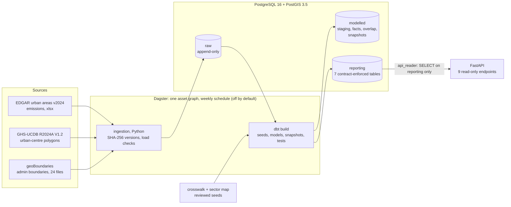
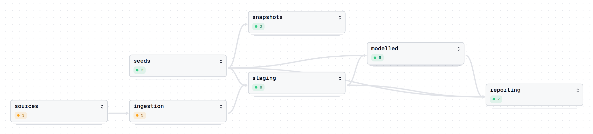

# city-emissions-platform

[](https://github.com/tom-cruiser/city-emissions-platform/actions/workflows/ci.yml)

This is a small data platform for greenhouse-gas emissions in 25 cities, most of them in
Africa and the Global South. It downloads the EU's EDGAR estimates of emissions per urban
area, matches each urban area to the city's official administrative boundary, and serves
the result through a read-only web API. The data model makes one point explicit: EDGAR measures a
satellite-defined *urban centre*, not the city, and in 12 of the 25 cities less than
half of that urban centre lies inside the city's boundary. Every figure the API returns is
labelled as the urban centre's, and carries that overlap, any data-quality flags, and the exact
source files it came from. It runs on PostgreSQL/PostGIS, dbt, Dagster and FastAPI, all
in Docker Compose.

## Architecture



Ingestion writes only `raw`. dbt reads `raw` and the seeds, then builds `modelled` and
`reporting`. The API's database role can read nothing but `reporting`.



*Dagster's lineage view of the real warehouse, by asset group. The 28 assets Dagster
can run (3 ingestion, 25 dbt) are grouped by layer. Numbers are assets per group. Green
means materialized by Dagster. The ingestion group is orange here because on this warehouse
the raw data was loaded with the CLI, before Dagster existed.*

## Key data findings

- **The urban centre is not the city.** In **12 of 25** cities, less than half of the
  urban centre EDGAR measures lies inside the city's administrative boundary
  (`low_urban_overlap`, threshold 0.5, [ADR 0001](docs/adr/0001-urban-centre-overlap.md)).
  The six largest emitters are all among them. Jakarta's urban centre (123 Mt CO2e in
  2022) is only 14% inside DKI Jakarta. Paris (7%) is a correct match with a low overlap.
- **Tests caught two wrong boundaries: Accra and Buenos Aires.** In both, the
  administrative unit is right but the geoBoundaries polygon is not:
  - **Accra:** the polygon is 5.7 km² against an official 20.4 km² (−72%), and only 0.5%
    of the 1,121 km² urban centre lies inside it. Two tests warn: the boundary-area test
    (more than 25% off the official area) and the 1% overlap test.
  - **Buenos Aires:** the polygon is 948 km² against about 200 km² (+374%). Its overlap
    (40%) looks normal, so only the area test catches it.

  Both are published with their flags and `needs_review`, never dropped. A test fails on
  purpose if either flag disappears without the crosswalk being fixed.
- **Sector figures are GPC-aligned, not a GPC inventory.** EDGAR's sectors are mapped
  to the GPC city-inventory sectors as labels, but the figures are scope 1 only, cover
  the urban centre, and are modelled top-down. The mapping is provisional, and nothing is
  summed into GPC totals ([ADR 0002](docs/adr/0002-edgar-to-gpc-sector-mapping.md)).

## Design decisions

- **Overlap as a flag, not a correction:** the API publishes the urban-centre figure
  with its overlap share and flags rather than rescaling it to the boundary.
  [ADR 0001](docs/adr/0001-urban-centre-overlap.md)
- **EDGAR sectors stay primary, GPC labels are provisional:** each row keeps its EDGAR
  sector and adds a GPC label with a mapping-quality grade, pending specialist review.
  [ADR 0002](docs/adr/0002-edgar-to-gpc-sector-mapping.md)
- **Layered schemas, access enforced by Postgres:** `raw`, `modelled` and `reporting`
  share one database, and the API's role can read `reporting` only.
  [ADR 0003](docs/adr/0003-layered-schemas.md)
- **Versions for sources, snapshots for edited seeds:** a source file's SHA-256 is its
  version, and dbt snapshots record changes to the crosswalk and sector map, which are
  edited in place. [ADR 0004](docs/adr/0004-dataset-versions-and-snapshots.md)
- **A read-only API over one reporting table per endpoint:** the API does no joins or
  calculations, so labels cannot drift, and it refuses any role that can do more than
  read. [ADR 0005](docs/adr/0005-read-only-api-over-reporting.md)
- **Synthetic EDGAR in the repo:** tests use a generated file with EDGAR's exact
  structure, because part of EDGAR's licence forbids redistributing derivatives.
  [ADR 0006](docs/adr/0006-synthetic-edgar-fixture.md)
- **GeoPackage read without GDAL:** a 125-line reader hands the geometry to PostGIS
  untouched and is cross-checked on every load.
  [ADR 0007](docs/adr/0007-geopackage-without-gdal.md)

Smaller decisions, each explained in the linked page:
- Cities are matched by ID through a reviewed crosswalk, never by name
  ([data quality](docs/data-quality.md)).
- Tests run against a separate `warehouse_test` database whose roles cannot reach the
  real one ([testing](docs/testing.md)).
- Load checks are stored next to the data in `raw.load_checks`
  ([ingestion](docs/ingestion.md)).
- dbt uses no packages, so CI needs no network for it ([dbt](docs/transform.md)).
- The API image installs only the API's 24 packages: no dbt and no Dagster
  ([design notes](docs/design-notes.md)).
- Every decision, including those not listed here, is in the
  [design notes](docs/design-notes.md).

## Quick start (5 minutes, offline)

Requires Docker and [uv](https://docs.astral.sh/uv/). This runs the whole pipeline on
the committed offline sample (synthetic EDGAR plus real boundary extracts) in
`warehouse_test`, then the tests and the API. Nothing is downloaded except Python
packages and the PostGIS image.

```bash
cp .env.example .env                  # then change the passwords
docker compose up -d --wait db        # PostGIS on 127.0.0.1:5434
uv sync                               # Python 3.12 + all dependency groups from uv.lock
uv run python -m ingestion load --mode sample --target test
scripts/dbt-build.sh test             # 7 reporting tables; 2 expected warnings (Accra, Buenos Aires)
uv run pytest -q                      # 186 tests, against warehouse_test only

# The API on the sample: http://127.0.0.1:8001/docs
set -a; . ./.env; set +a
POSTGRES_DB=$TEST_POSTGRES_DB API_READER_USER=$TEST_API_READER_USER \
  API_READER_PASSWORD=$TEST_API_READER_PASSWORD \
  uv run uvicorn --factory api.main:create_app --port 8001
curl -s http://127.0.0.1:8001/v1/cities/accra-gha     # flags, review status, versions
```

From a fresh clone this took 2 min 12 s, with the PostGIS image and uv cache already
present. The sample's emissions are invented, so only the real data's figures mean
anything.

- **Real data:** the full download is ~375 MB, then the API runs in Compose. See
  [Running the platform](docs/running.md).
- **Dagster:** `PIPELINE_TARGET=test scripts/dagster-dev.sh` opens the lineage above on
  the sample at http://127.0.0.1:3030. See [Orchestration](docs/orchestration.md).

## Testing

- **186 pytest tests:** ingestion, the dbt project's rules, the API (values, labels,
  pagination, errors, the OpenAPI contract) and Dagster job runs.
- **187 dbt tests** on every build, in two severities:
  - **error:** keys, row counts, GHG ≥ CO2, units, geometry, flag consistency, and
    known revisions;
  - **warn:** data findings such as Accra and Buenos Aires.
- **Tests can never reach the real warehouse.** They connect with roles that cannot
  reach it, behind a database-name guard, and every database test rolls back.
- **Synthetic EDGAR data** is refused by any database not named `*_test`.

See [Testing and CI](docs/testing.md).

## CI

GitHub Actions runs on every push and pull request to `main`, and has three jobs:
- **`test`:** ruff, then the offline sample into PostGIS through the same Compose
  setup, `dbt build`, `dagster definitions validate`, pytest, and a check that the run
  changed no tracked file.
- **`api-image`:** builds the API image (never pushed).
- **`orchestration-image`:** builds the Dagster image (never pushed).

Actions are pinned to commit SHAs. Failures are listed on the run's summary page. See
[Testing and CI](docs/testing.md#continuous-integration).

## Data sources and licences

| Source | Used for | Licence | In the repo |
|---|---|---|---|
| [EDGAR emissions in urban areas v2024](https://edgar.jrc.ec.europa.eu/dataset_ucdb) (EC JRC) | emissions per urban centre, sector, year (1975–2022) | IEA-EDGAR CO2 part **CC BY-NC-ND 4.0** | **no:** downloaded at run time; a synthetic file stands in |
| [GHS-UCDB R2024A V1.2](https://human-settlement.emergency.copernicus.eu/ghs_ucdb_2024.php) (EC JRC) | urban-centre polygons | CC BY 4.0 | 25 polygons, unchanged |
| [geoBoundaries gbOpen](https://www.geoboundaries.org) (William & Mary geoLab) | administrative boundaries | per country: CC BY, ODbL, public domain and others | 24 files, unmodified |

The citations, per-country licences and sources evaluated but not used are in
[Data sources and licences](docs/data-sources.md).

## Limitations

- **The figures are not "emissions inside this boundary."** They cover the urban centre.
  Use the overlap share and flags that come with every figure.
- **The polygons may not be EDGAR's.** See [Open questions](#open-questions).
- **Official areas are mostly secondary sources.** Wikipedia is used for 23 cities. That
  is enough for a 25% sanity check, not an authoritative figure.
- **London is excluded.** No single geoBoundaries unit matches Greater London.
- **Downloads are not cached**, so each scheduled run re-fetches ~375 MB. Identical
  files are then skipped at load.
- **Some operations are still manual:** no migration tool, no alerting, and the snapshot
  backup is run by hand. See the [design notes](docs/design-notes.md#known-limitations).
- **The API has no authentication or rate limiting.** The data is public and read-only;
  a production deployment would put both in a gateway.

## Open questions

- **Sector mapping review.** The EDGAR → GPC mapping, including its `approximate` and
  `mixed` grades, has not been reviewed by a city GHG inventory specialist. Every row is
  `needs_review` until it is ([ADR 0002](docs/adr/0002-edgar-to-gpc-sector-mapping.md)).
- **Urban-centre release mismatch.** EDGAR v2024 uses 11,686 urban-centre IDs.
  GHS-UCDB V1.2, which supplies the polygons here, has 11,422. All 25 crosswalk cities
  match by ID, name and country, but their V1.2 polygons are not verified to be the
  shapes EDGAR computed emissions on. Checking needs the earlier UCDB release, so overlap
  figures describe the V1.2 polygon.
- **Methodology thresholds.** The 0.5 overlap threshold and the 25% area tolerance are
  engineering choices that a domain specialist should confirm. They are dbt vars, so
  changing them needs no code change.
- **Better boundaries for Accra and Buenos Aires.** Both need either a better polygon
  source or a decision to accept the flagged figures.

## Next steps

Orchestration follow-ups:
- run the snapshot backup before each Dagster build;
- alert on failed runs and failed freshness checks;
- check the API's `/ready` after a build;
- use conditional downloads (ETag), so the weekly run doesn't re-fetch ~375 MB.

## Documentation

- [Running the platform](docs/running.md): full setup, real-data loads, backups
- [Architecture](docs/architecture.md): layers, raw tables, repository layout
- [Ingestion](docs/ingestion.md): dataset versions, samples, synthetic fixture, load checks
- [dbt: modelled and reporting layers](docs/transform.md): models, tests, revisions, snapshots
- [Orchestration (Dagster)](docs/orchestration.md): assets, schedule, checks, failure handling
- [API (FastAPI)](docs/api.md): endpoints, labels, errors, read-only guarantees
- [Testing and CI](docs/testing.md)
- [Cities and data quality](docs/data-quality.md): the crosswalk and every finding so far
- [Data sources and licences](docs/data-sources.md)
- [Architecture decision records](docs/adr/) (0001–0007)
- [Design notes](docs/design-notes.md): every design decision and limitation in full
- [Build history](docs/build-history.md): what each stage delivered
