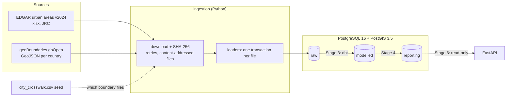
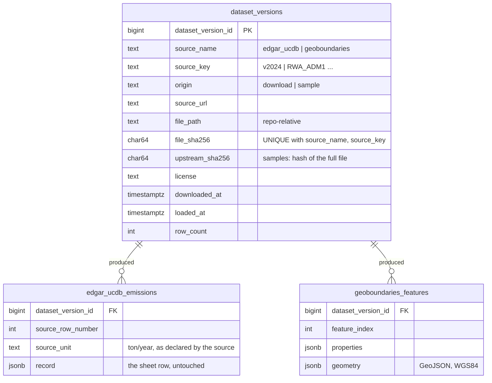

# city-emissions-platform

A small, production-shaped data platform for **city-level greenhouse-gas emissions**.
It ingests open emissions data and city boundaries, models them in layered
PostgreSQL/PostGIS storage with dbt, orchestrates with Dagster, and serves curated
data through a read-only FastAPI service.

> **Status: work in progress.** Stages 1–2 are built; Stage 2 has three open items.
> See [Build status](#build-status). This README describes only what exists today and
> marks everything planned as such.

## Build status

| Stage | Scope | Status |
|---|---|---|
| 1 | Repo structure, Docker Compose, PostGIS, schemas and roles | ✅ Done |
| 2 | Source verification, Python ingestion into `raw`, dataset versioning | 🟡 Mostly done: open items below |
| 3 | dbt: modelled layer, seeds, tests | ⏳ Planned |
| 4 | Reporting layer and dbt snapshots | ⏳ Planned |
| 5 | Dagster orchestration | ⏳ Planned |
| 6 | FastAPI service and tests | ⏳ Planned |
| 7 | GitHub Actions CI | ⏳ Planned |
| 8 | Full docs, diagrams, ADRs | ⏳ Planned |

**Open items in Stage 2**

1. **Synthetic EDGAR fixture.** Real EDGAR rows are deliberately *not* committed (see
   [licences](#data-sources--licences)). A synthetic file with the same structure and
   invented values will replace them. Until then `--mode sample` loads boundaries only,
   and the EDGAR sample reader test is skipped.
2. **Separate `warehouse_test` database.** Tests currently run against the dev
   `warehouse` database inside a transaction that is always rolled back. They will move
   to a dedicated test database whose roles cannot connect to `warehouse` at all.
3. **GHS-UCDB urban-centre polygons.** EDGAR emissions will be attached to their own
   urban-centre polygons, with a PostGIS overlap ratio against each city's administrative
   boundary and a flag on low-overlap pairs.

## Architecture (current)



Dotted lines are planned.

### Layered schemas and access

| Schema | Contents | Written by | Read by |
|---|---|---|---|
| `raw` | Source data exactly as loaded, plus `dataset_versions`. Append-only. | `pipeline` role | `pipeline` |
| `modelled` | Cleaned, typed, conformed data (planned, dbt) | `pipeline` | `pipeline` |
| `reporting` | Aggregates the API serves (planned, dbt) | `pipeline` | `pipeline`, **`api_reader`** |

The database enforces "the API never reads raw": `api_reader` has `SELECT` on
`reporting` only, and gets `permission denied` on `raw`. `ALTER DEFAULT PRIVILEGES`
keeps that grant on tables that dbt drops and recreates. See `db/init/01-init.sh`.

### Raw tables



## Quick start

Requires Docker and [uv](https://docs.astral.sh/uv/) (uv installs Python 3.12 itself).

```bash
cp .env.example .env                 # then change the passwords
docker compose up -d --wait          # PostGIS on 127.0.0.1:5434
uv sync                              # Python 3.12 environment from uv.lock

uv run python -m ingestion load --mode sample     # offline: committed sample
uv run python -m ingestion load --mode download   # real files (~25 MB + boundaries)
uv run pytest -q
```

Re-running a load is safe: a file whose SHA-256 is already recorded is skipped.

Inspect what was loaded:

```bash
docker compose exec db psql -U climate -d warehouse -c \
  "SELECT dataset_version_id, source_name, source_key, origin, row_count, left(file_sha256,12), loaded_at
   FROM raw.dataset_versions ORDER BY 1"
```

`docker compose down -v` deletes the database volume. The init scripts in `db/init/`
only run against an empty volume.

## Project layout

```
db/init/01-init.sh          PostGIS, schemas, roles, grants (runs once on an empty volume)
ingestion/
  __main__.py               CLI: load --mode sample|download, make-sample
  config.py                 source URLs, paths, DB settings (.env)
  download.py               streaming download, SHA-256, retries with backoff
  versioning.py             raw.dataset_versions: idempotent registration
  edgar.py                  EDGAR workbook reader + loader (fails loudly on layout change)
  geoboundaries.py          geoBoundaries API resolution, GeoJSON reader + loader
  crosswalk.py              reads the city crosswalk seed
  pipeline.py               download / sample runs, one transaction per file
  sample.py                 rebuilds data/sample from the latest downloads
  sql/raw_tables.sql        raw DDL (idempotent)
transform/seeds/city_crosswalk.csv   the 25 cities: EDGAR id <-> geoBoundaries shape
data/sample/                committed offline sample + manifest.json
data/raw/                   full downloads (git-ignored), named <sha256-prefix>_<file>
tests/                      pytest: unit + rolled-back DB integration tests
transform/, orchestration/  dbt (Stage 3) and Dagster (Stage 5)
```

`transform/` and `orchestration/` are deliberately not called `dbt/` and `dagster/`.
`dbt` is a Python namespace package, so a `dbt/` folder at the repo root gets merged
into it (`dbt.__path__` showed the repo folder). That would cause confusing import
bugs later.

## How ingestion works

**Dataset versions.** Every loaded file gets a row in `raw.dataset_versions` with its
source URL, SHA-256, size, download time, load time and licence. Every raw row carries
`dataset_version_id`. The modelled and reporting layers will carry it forward, so any
number can be traced back to the exact bytes it came from.

**Idempotency.** `(source_name, source_key, file_sha256)` is unique, and registration
uses `INSERT ... ON CONFLICT DO NOTHING`. The same bytes give a no-op. Changed bytes
give a new version, and the old one stays (raw is append-only). This is also safe when
two loads race.

**Failure handling.**
- Each file loads in its own transaction, so a failure leaves nothing half-written and
  never undoes files that already loaded.
- Downloads retry timeouts, 429 and 5xx with exponential backoff (~3 min worst case).
  geoBoundaries is served via GitHub LFS, which returns intermittent 504s.
- 404 and other client errors fail immediately.
- A failing country is reported, the run continues, and the CLI exits non-zero.

**Raw is untouched.** EDGAR rows are stored as JSON exactly as read, plus the unit the
source declares (`ton/year`). Boundaries are stored as GeoJSON. Typing, unpivoting,
unit handling, name repair and conversion to PostGIS geometry belong to the modelled
layer (Stage 3).

**Samples.** `python -m ingestion make-sample` cuts the crosswalk cities out of the
latest downloaded files. It keeps their original format, so the same loader reads
both. `manifest.json` records the upstream URL and SHA-256 each sample came from, and
sample versions are stored with `origin = 'sample'` and `upstream_sha256`.

## City matching (crosswalk)

The platform covers **25 cities in 24 countries, 11 of them in Africa**:
Kigali, Nairobi, Lagos, Bujumbura, Kampala, Addis Ababa, Dar es Salaam, Accra,
Johannesburg, Cape Town, Dakar, Kinshasa, Cairo, Buenos Aires, Mexico City, Bogotá,
Lima, Delhi, Jakarta, Bangkok, Seoul, Tokyo, Berlin, Paris, São Paulo.

`transform/seeds/city_crosswalk.csv` maps each city to an EDGAR urban-centre ID
(`edgar_uc_id`) and a geoBoundaries shape (`gb_shape_id`), with a note per match. The
join is by ID and never by name, because names in these sources are unreliable:

- EDGAR has **192 duplicate (name, country) pairs**.
- Spellings differ: `Dar es-Salaam`, and Delhi's urban centre is `Ghaziabad [New Delhi]`.
- The obvious admin match can be wrong. geoBoundaries' UK ADM2 has *City of London*,
  the 2.9 km² financial district, not Greater London (33 boroughs). London is therefore
  **excluded** rather than silently mismatched.
- The right admin level varies by country. Uganda's ADM1 is only 4 regions, so Kampala
  is ADM2. Lima uses the metropolitan municipality, not the Lima region.

`make-sample` fails if any crosswalk `gb_shape_id` is missing upstream, which would mean
geoBoundaries re-issued its IDs.

## Data quality findings so far

| Finding | Where | Handling |
|---|---|---|
| 775 names mis-encoded (UTF-8 read as Latin-1), e.g. `São Paulo`, `México` | EDGAR source file | Kept as-is in raw; repair planned in the modelled layer |
| 192 duplicate (name, country) pairs | EDGAR | Join on IDs via the crosswalk |
| No negative or blank values across 11,686 rows | EDGAR | Will become a dbt test |
| Licence text truncated inside the file ("Unl…", "compli…") | EDGAR citations sheet | Licence recorded only as far as verified |
| Intermittent HTTP 504 | geoBoundaries (GitHub LFS) | Retries with backoff; per-file isolation |
| Urban centre ≠ administrative area | EDGAR vs geoBoundaries | Overlap analysis planned (Stage 2, item 3) |

## Data sources & licences

| Source | Used for | Licence | Committed to this repo? |
|---|---|---|---|
| **EDGAR – Global emissions in urban areas, v2024** (European Commission, JRC) [dataset page](https://edgar.jrc.ec.europa.eu/dataset_ucdb) | GHG per urban centre and sector, 1975–2022, t CO2e (GWP100, AR5) | © European Union 2024, JRC. The IEA-EDGAR CO2 component (fossil fuel combustion) is **CC BY-NC-ND 4.0**. The general licence text is truncated in the file and not stated on the [terms page](https://edgar.jrc.ec.europa.eu/terms). | **No.** Downloaded at run time. Committed tests will use a clearly labelled synthetic fixture. |
| **geoBoundaries gbOpen** (William & Mary geoLab) [geoboundaries.org](https://www.geoboundaries.org) | Administrative boundaries, ADM1/ADM2 | Per country, see below | Yes: one polygon per city, unmodified, in `data/sample/geoboundaries/` |
| **GHS Urban Centre Database R2024A** (European Commission, JRC, GHSL) [product page](https://human-settlement.emergency.copernicus.eu/ghs_ucdb_2024.php) | Urban-centre polygons (*planned*) | Reuse authorised with acknowledgement; GHSL data are described as CC BY 4.0 | Planned |

EDGAR citation (from the dataset page): Crippa, M. et al., *EDGAR_emissions_urban_areas*,
European Commission, Joint Research Centre (JRC), http://data.europa.eu/89h/c0c49cd7-4a80-4a94-8c34-375289c12b2d.
See also Crippa et al. (2021), *Environmental Research Letters* 16, 074033,
doi:10.1088/1748-9326/ac00e2.

geoBoundaries citation: Runfola, D. et al. (2020), *geoBoundaries: A global database of
political administrative boundaries*, PLoS ONE 15(4): e0231866.

**geoBoundaries licences per file** (as reported by the geoBoundaries API; each file is
fetched from a commit-pinned GitHub URL, recorded in `raw.dataset_versions.source_url`):

| Licence | Countries |
|---|---|
| CC BY 4.0 | ETH, GHA, NGA, RWA |
| CC BY 3.0 IGO | BRA, MEX, SEN, ZAF |
| CC BY 2.5 (Generic / India) | ARG, IND |
| ODbL 1.0 (share-alike for databases) | COD, COL, EGY, IDN, JPN, THA, TZA |
| Data licence Germany – Attribution 2.0 | DEU |
| Etalab Open Licence 2.0 | FRA |
| Public domain / CC0 | BDI, KEN, KOR, PER, UGA |

**Sources evaluated and not used**

- **CDP open data** (data.cdp.net) returns HTTP 403 to automated clients. A scheduled
  pipeline cannot depend on it, and its bot protection was not circumvented.
- **Climate TRACE**: the API is officially beta, and a city search for "Kigali" returned
  no results. Its city data is offered via manual downloads on the Explore page.

## Design decisions (so far)

- **Schemas, not separate databases, for layers.** dbt has to join across layers, and
  Postgres cannot join across databases without extensions.
- **Least-privilege roles enforced in the database**, not by convention.
- **Raw rows as JSONB.** A new year column upstream does not break the load, and raw
  stays exactly as published.
- **Content-hash dataset versions.** The SHA-256 *is* the version, which gives
  idempotency and lineage from one mechanism.
- **Admin boundaries plus a reviewed crosswalk, joined by ID.** Cities report emissions
  for their administrative territory, and names are too unreliable to join on.
- **Python 3.12 only.** dagster-dbt 0.29.28 declares `requires_python <3.14`. uv
  ignores that cap and would install on 3.14, but pip correctly refuses, so 3.14 is
  unsupported here. 3.11–3.13 all install and import cleanly.

## Known limitations

- **Urban centre ≠ city boundary.** EDGAR measures a satellite-derived urban centre,
  while boundaries are administrative. Extents can differ greatly; Jakarta's urban
  centre (123 Mt CO2e) extends well beyond DKI Jakarta. This will be quantified with the
  planned overlap analysis. Until then, do not read an emissions figure as "emissions
  inside this boundary".
- **London is excluded:** no single geoBoundaries unit for Greater London at ADM2.
- **No migrations tool yet.** The raw DDL is `CREATE TABLE IF NOT EXISTS`, so changing an
  existing table needs a manual `ALTER` (or recreating the volume).
- **Tests use the dev database** until the separate `warehouse_test` database lands.

## Next steps

Finish the three Stage 2 open items above, then Stage 3 (dbt).
