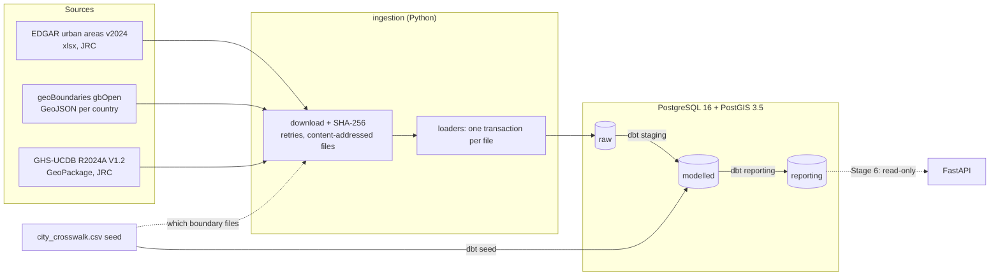
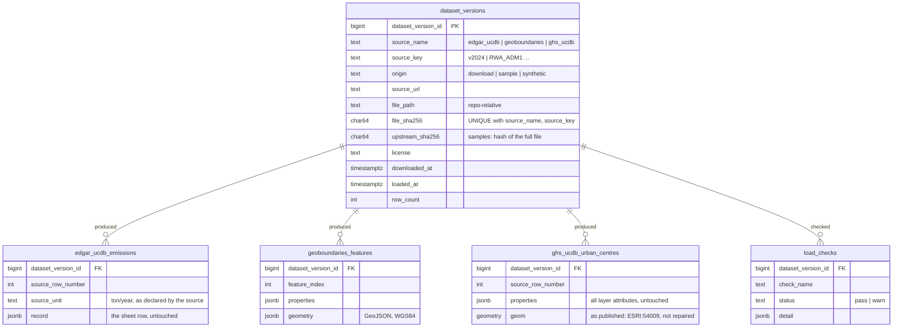

# city-emissions-platform

A small, production-shaped data platform for **city-level greenhouse-gas emissions**.
It ingests open emissions data and city boundaries, models them in layered
PostgreSQL/PostGIS storage with dbt, orchestrates with Dagster, and serves curated
data through a read-only FastAPI service.

> **Status: work in progress.** Stages 1–4 are built; Stage 5 (Dagster orchestration) is next.
> See [Build status](#build-status). This README describes only what exists today and
> marks everything planned as such.

## Build status

| Stage | Scope | Status |
|---|---|---|
| 1 | Repo structure, Docker Compose, PostGIS, schemas and roles | ✅ Done |
| 2 | Source verification, Python ingestion into `raw`, dataset versioning, load checks | ✅ Done |
| 3 | dbt: modelled layer, seeds, tests | ✅ Done |
| 4 | Reporting layer and dbt snapshots | ✅ Done |
| 5 | Dagster orchestration | ⏳ Planned |
| 6 | FastAPI service and tests | ⏳ Planned |
| 7 | GitHub Actions CI | ⏳ Planned |
| 8 | Full docs, diagrams, ADRs | ⏳ Planned |

**Stage 2 items**

1. ✅ **Synthetic EDGAR fixture.** Real EDGAR rows are deliberately *not* committed (see
   [licences](#data-sources--licences)). The offline sample uses a synthetic file with
   EDGAR's exact structure and invented values. See [Synthetic EDGAR fixture](#synthetic-edgar-fixture).
2. ✅ **Separate `warehouse_test` database.** Tests run only against `warehouse_test`,
   whose roles cannot connect to `warehouse`. See [Testing](#testing).
3. ✅ **GHS-UCDB urban-centre polygons.** The polygons EDGAR's emissions are computed on
   are loaded into `raw` with load checks. See [GHS-UCDB urban centres](#ghs-ucdb-urban-centres).
   The overlap with administrative boundaries is *not* computed here: it belongs to dbt
   (Stage 3), as decided in [ADR 0001](docs/adr/0001-urban-centre-overlap.md).

**Stage 3 items**

1. ✅ **dbt project** in `transform/`: seeds, 5 staging and 4 modelled models, 79 tests. See
   [Modelled layer (dbt)](#modelled-layer-dbt).
2. ✅ **Overlap model** `city_territory_overlap` (ADR 0001): ratios in Mollweide, km² geodesic,
   `low_urban_overlap` at `var('min_urban_overlap')` = 0.5, warn test at 0.01 for suspected
   crosswalk errors.
3. ✅ **Provisional EDGAR → GPC sector mapping**, [ADR 0002](docs/adr/0002-edgar-to-gpc-sector-mapping.md),
   pending specialist review. Sectors are called *GPC-aligned*, never a *GPC inventory*.
4. ✅ **Guard**: sample/synthetic data is refused by any database not named `*_test`, in
   ingestion and in dbt.

**Stage 4 items**

1. ✅ **Reporting layer**: 7 models in `reporting`, designed backwards from the API
   endpoints, each a table with an enforced dbt contract. Every emissions figure is labelled
   as the emissions of the city's *urban centre* and carries its overlap, flags, review
   status and dataset versions. `api_reader` is tested to read every one after a rebuild.
   See [Reporting layer (dbt)](#reporting-layer-dbt).
2. ✅ **Snapshots** of the crosswalk and the sector map, both edited in place, with a
   `pg_dump` backup because they cannot be rebuilt. See [Snapshots](#snapshots).
3. ✅ **Revisions** between EDGAR versions, modelled by comparing dataset versions
   (`city_emission_revisions`). Tested on `warehouse_test` with a second, *revised*
   synthetic EDGAR file; empty on the real warehouse until a second EDGAR version exists.
   See [Revisions between EDGAR versions](#revisions-between-edgar-versions).

## Architecture (current)



Dotted lines are planned (the API), or a lookup rather than data flow (which boundary files to fetch).

### Layered schemas and access

| Schema | Contents | Written by | Read by |
|---|---|---|---|
| `raw` | Source data exactly as loaded, plus `dataset_versions`. Append-only. | `pipeline` role | `pipeline` |
| `modelled` | dbt seeds, `stg_*` staging models, and the modelled layer (dims, facts, overlap) | `pipeline` | `pipeline` |
| `reporting` | The tables the API serves (dbt, contract-enforced) | `pipeline` | `pipeline`, **`api_reader`** |

The database enforces "the API never reads raw": `api_reader` has `SELECT` on
`reporting` only, and gets `permission denied` on `raw`. `ALTER DEFAULT PRIVILEGES`
keeps that grant on tables that dbt drops and recreates. See `db/init/lib/layers.sql`.
That only works while dbt connects as `pipeline` (the role named in the default
privileges), so every build checks it: `tests/assert_api_reader_can_read_reporting.sql`.

### Raw tables



## Quick start

Requires Docker and [uv](https://docs.astral.sh/uv/) (uv installs Python 3.12 itself).

```bash
cp .env.example .env                 # then change the passwords
docker compose up -d --wait          # PostGIS on 127.0.0.1:5434 (warehouse + warehouse_test)
uv sync                              # Python 3.12 environment from uv.lock

uv run python -m ingestion load --mode download                # real files into warehouse (~25 MB EDGAR, ~70 MB boundaries, 277 MB GHS-UCDB)
uv run python -m ingestion load --mode sample --target test    # offline: 2 synthetic EDGAR versions + real extracts into warehouse_test
uv run pytest -q                                               # runs against warehouse_test only

# dbt (Stage 3). --env-file passes .env to dbt; profiles.yml holds no secrets.
uv run --env-file .env dbt build --project-dir transform --profiles-dir transform               # warehouse (download data)
uv run --env-file .env dbt build --project-dir transform --profiles-dir transform --target test # warehouse_test (sample)
```

A full `dbt build` on the real warehouse takes about 40 s (2.24M emission rows).

Re-running a load is safe: a file whose SHA-256 is already recorded is skipped.

> **Sample mode loads synthetic emissions, so it only loads into `warehouse_test`.** Any
> emissions number it produces is invented. Sample and synthetic data are refused by any
> database whose name does not end in `_test`: `load --mode sample` without
> `--target test` exits with an error before writing anything. The check runs on the
> database the connection actually reached, at the start of the sample run and again in
> `register_version`, which every loader goes through (`tests/ingestion/test_test_db_guard.py`).
> It exists because on 2026-11-07 a sample load reached the real warehouse by mistake;
> that was removed with [`db/corrections/2026-11-07_remove_sample_versions_from_warehouse.sql`](db/corrections/2026-11-07_remove_sample_versions_from_warehouse.sql).

**Created your volume before `warehouse_test` existed?** The init scripts only run on an
empty volume. Add it without losing data:

```bash
docker compose up -d --wait   # recreate the container so it sees the TEST_* variables
docker compose exec db bash /docker-entrypoint-initdb.d/02-test-db.sh   # idempotent
```

Inspect what was loaded:

```bash
docker compose exec db psql -U climate -d warehouse -c \
  "SELECT dataset_version_id, source_name, source_key, origin, row_count, left(file_sha256,12), loaded_at
   FROM raw.dataset_versions ORDER BY 1"
```

`docker compose down -v` deletes the database volume. The init scripts in `db/init/`
only run against an empty volume.

> ⚠️ **Back up the snapshots before `docker compose down -v`.** Everything else in the
> database can be rebuilt (ingestion from the source files, dbt from `raw`), but the dbt
> snapshot tables hold history that exists nowhere else. Run the backup command in
> [Snapshots](#snapshots) first.

## Project layout

```
db/init/
  01-init.sh                warehouse: roles pipeline + api_reader (runs once on an empty volume)
  02-test-db.sh             warehouse_test: roles test_pipeline + test_api_reader (idempotent)
  lib/layers.sql            shared: PostGIS, schemas, CONNECT/USAGE/SELECT grants
db/corrections/             one-off, documented data corrections (each says what, why, how to run)
ingestion/
  __main__.py               CLI: load --mode download|sample [--target warehouse|test], make-sample, make-synthetic
  config.py                 source URLs, paths, DB settings (.env)
  download.py               streaming download, SHA-256, retries with backoff
  versioning.py             raw.dataset_versions: idempotent registration
  edgar.py                  EDGAR workbook reader + loader (fails loudly on layout change)
  geoboundaries.py          geoBoundaries API resolution, GeoJSON reader + loader
  gpkg.py                   GeoPackage reader: stdlib sqlite3 + GPKG blob header, no GDAL
  ghs_ucdb.py               GHS-UCDB loader + load checks (raw.load_checks)
  crosswalk.py              reads the city crosswalk seed
  pipeline.py               download / sample runs, one transaction per file
  sample.py                 rebuilds the boundary and GHS-UCDB samples; writes manifest.json
  synthetic.py              generates the SYNTHETIC EDGAR-shaped fixture (seeded, reproducible)
  sql/raw_tables.sql        raw DDL (idempotent)
transform/                  dbt project (Stage 3)
  dbt_project.yml, profiles.yml   targets: warehouse, test (warehouse_test)
  seeds/                    city_crosswalk.csv (25 cities), edgar_sector_map.csv, edgar_pollutants.csv
  models/staging/           stg_* : one version per source, names repaired, geometry repaired
  models/modelled/          dim_city, fct_urban_centre_emissions, fct_city_emissions, city_territory_overlap
  models/reporting/         what the API serves: cities, city_emissions, city_emissions_trend,
                            city_boundaries, city_overlap, dataset_versions, city_emission_revisions
                            (contracts enforced)
  snapshots/                snap_city_crosswalk, snap_edgar_sector_map (history of seeds edited in place)
  macros/                   raw_origins (guard), unpivot_edgar_emissions, repair_mojibake, overlap_metrics,
                            change_pct, schema naming
  tests/                    generic tests (no packages) + singular tests
data/sample/                committed offline sample + manifest.json
  edgar/…_SYNTHETIC.xlsx    invented values, real structure
  edgar/…_SYNTHETIC_REVISED.xlsx   the same, re-published with known corrections (2nd version)
  geoboundaries/            real polygons for the 25 cities, unmodified
  ghs_ucdb/…_crosswalk_cities.gpkg   the 25 crosswalk urban centres, one layer (160 KB)
data/raw/                   full downloads (git-ignored), named <sha256-prefix>_<file>
backups/                    snapshot backups from pg_dump (git-ignored)
tests/                      pytest against warehouse_test: unit + rolled-back integration tests
  transform/                rules on the parsed dbt project; api reader access after dbt build
orchestration/              Dagster (Stage 5)
docs/adr/                   architecture / methodology decision records
```

`transform/` and `orchestration/` are deliberately not called `dbt/` and `dagster/`.
`dbt` is a Python namespace package, so a `dbt/` folder at the repo root gets merged
into it (`dbt.__path__` showed the repo folder). That would cause confusing import
bugs later.

## How ingestion works

**Dataset versions.** Every loaded file gets a row in `raw.dataset_versions` with its
source URL, SHA-256, size, download time, load time and licence. Every raw row carries
`dataset_version_id`. The modelled and reporting layers will carry it forward, so any
number can be traced back to the exact bytes it came from.

**Idempotency.** `(source_name, source_key, file_sha256)` is unique, and registration
uses `INSERT ... ON CONFLICT DO NOTHING`. The same bytes give a no-op. Changed bytes
give a new version, and the old one stays (raw is append-only). This is also safe when
two loads race.

**Failure handling.**
- Each file loads in its own transaction, so a failure leaves nothing half-written and
  never undoes files that already loaded.
- Downloads retry timeouts, 429 and 5xx with exponential backoff (~3 min worst case).
  geoBoundaries is served via GitHub LFS, which returns intermittent 504s.
- 404 and other client errors fail immediately.
- A failing country is reported, the run continues, and the CLI exits non-zero.

**Raw is untouched.** EDGAR rows are stored as JSON exactly as read, plus the unit the
source declares (`ton/year`). Boundaries are stored as GeoJSON. Typing, unpivoting,
unit handling, name repair and conversion to PostGIS geometry belong to the modelled
layer (Stage 3).

**Samples.** `data/sample/manifest.json` lists every committed file and where it came
from. Each file is loaded with the same loader as the real data.

| Sample file | `origin` | Built by | Provenance recorded |
|---|---|---|---|
| geoBoundaries GeoJSON (24 files) | `sample` | `make-sample` cuts the crosswalk cities out of the latest downloads | upstream URL + `upstream_sha256` + download time |
| GHS-UCDB GeoPackage | `sample` | `make-sample` copies the 25 crosswalk urban centres of one layer out of the latest download | upstream URL + `upstream_sha256` (of the zip) + download time; licence text lists the changes |
| EDGAR workbook | `synthetic` | `make-synthetic` generates it, no download involved | `source_url = synthetic:ingestion/synthetic.py`, no upstream hash |

### Synthetic EDGAR fixture

`ingestion/synthetic.py` writes `EDGAR_emiss_on_UCDB_2024_SYNTHETIC.xlsx`:

- **Same structure as EDGAR v2024.** Same sheet names, the `Units` row, and the 195-column
  header (`ID_UC_G0`, `UC_name`, `UC_country`, then `EMI_<pollutant>_<sector>_<year>`).
  The generated header was checked against the real file and is identical.
- **Invented values.** Every number comes from a seeded random generator. Columns
  stay internally consistent: total GHG in CO2e is never below CO2, and nothing is
  negative.
- **Deliberate edge cases** for the modelled layer:
  - the mis-encoded names exactly as EDGAR has them (`São Paulo`, `México`);
  - a second `Lagos, Nigeria` with a fake ID (990001), so a join by name would
    double-count Lagos;
  - an urban centre outside the crosswalk (990002);
  - a sector that is zero in every year.
- **Clearly labelled.** The filename, the first sheet ("SYNTHETIC DATA - NOT EDGAR"),
  the manifest and `raw.dataset_versions.origin = 'synthetic'` all say so.
- **Byte-for-byte reproducible.** An `.xlsx` is a zip, and openpyxl stamps entries and
  the `modified` property with the current time. The generator pins both, so
  regenerating gives the same SHA-256 and therefore no new dataset version.

The urban-centre IDs and names in it are real. They come from the GHS Urban Centre
Database (CC BY 4.0) and are needed to match the crosswalk.

**The revised fixture.** `…_SYNTHETIC_REVISED.xlsx` is the same release re-published with a
few cells corrected (`synthetic.REVISIONS`), the way a source can silently fix a file
under the same name. It is generated from the same random draws, so it differs *only* in
those cells (`test_revised_fixture_differs_only_in_the_listed_cells`):

| Urban centre | Sector, year | Pollutants | Factor |
|---|---|---|---|
| Kigali (597) | Transport 2022 | CO2 and GHG | ×1.25 |
| Nairobi (1717) | Energy 1990 | CO2 and GHG | ×0.8 |
| Lagos (1289) | Residential 2015 | PM2.5 | ×1.5 |
| Synthetic Town (990002, not in the crosswalk) | Waste 2020 | CO2 and GHG | ×2 |

CO2 and GHG are scaled together, so GHG ≥ CO2 still holds. The manifest lists it after the
original with a later `generated_at`, and the sample load runs in manifest order. So
`warehouse_test` holds two dataset versions of EDGAR `v2024`, and the revised one is current.

## GHS-UCDB urban centres

EDGAR computes emissions per GHS urban centre. To compare those territories with the
administrative boundaries, the urban-centre polygons are loaded from
[GHS-UCDB R2024A V1.2](https://human-settlement.emergency.copernicus.eu/ghs_ucdb_2024.php)
(a 277 MB zip holding one 285 MB GeoPackage with 16 layers).

- **One layer.** All 15 thematic layers repeat the same 11,422 polygons. Only
  `GHSL_UCDB_THEME_GENERAL_CHARACTERISTICS_GLOBE_R2024A` is loaded: ID, names, country,
  area, population, geometry.
- **No GDAL.** `ingestion/gpkg.py` reads the file with stdlib `sqlite3` and parses the
  GeoPackageBinary header (magic, flags, SRS id, envelope) itself. The WKB after the header
  goes to PostGIS untouched (`ST_GeomFromWKB`). Header parsing is tested on constructed
  blobs (both byte orders, every envelope size, malformed input) and on the 25 real
  polygons, against an independent pure-Python WKB reader.
- **Stored as published.** Native CRS (World Mollweide, ESRI:54009), no reprojection, no
  repair. The downloaded zip is the dataset version. The extracted `.gpkg` next to it is
  a cache named after the zip's hash.

### Load checks

Every GHS-UCDB load runs these checks in the same transaction as the rows. A failing
check raises and rolls the file back. Passes and warnings go to `raw.load_checks`.

| Check | Fails when | Result on the full file (11,422 polygons) |
|---|---|---|
| `row_count` | rows in raw ≠ features in the layer | pass: 11,422 = 11,422 |
| `gpkg_header` | a blob's SRS id ≠ the layer's, or its envelope ≠ the bounds PostGIS computes from the WKB | pass: 0 mismatches |
| `srid` | layer SRS is not ESRI:54009, it is missing from `spatial_ref_sys`, or a stored SRID differs | pass: all 54009 (`World_Mollweide`, present in the stock PostGIS image) |
| `geometry_type` | anything other than (MULTI)POLYGON | pass: 11,422 MULTIPOLYGON |
| `geometry_valid` | never fails; warns on invalid polygons | **warn: 22 invalid** (all ring self-intersections, none of our 25 cities); `ST_CollectionExtract(ST_MakeValid(geom), 3)` repairs all 22 |
| `area_vs_source` | warns if `ST_Area` differs from the source's `GC_UCA_KM2_2025` by > 5% | pass: identical for all 11,422 (the polygons are unions of 1 km² Mollweide cells) |
| `id_match_edgar` | null or duplicate IDs, or a crosswalk city missing from UCDB | **warn: 11,422 matched, 264 EDGAR-only, 0 UCDB-only**; all 25 crosswalk cities present in both |

Inspect them:

```bash
docker compose exec db psql -U climate -d warehouse -c \
  "SELECT check_name, status, detail->>'summary' FROM raw.load_checks ORDER BY dataset_version_id, check_name"
```

### Overlap with administrative boundaries (built in Stage 3)

Computed in dbt, not ingestion. The full decision and its reasoning are in
[ADR 0001](docs/adr/0001-urban-centre-overlap.md).

- **Staging repairs geometry** with `ST_CollectionExtract(ST_MakeValid(geom), 3)`. Raw is
  never modified.
- **Areas are compared in Mollweide** (ESRI:54009), with boundaries transformed from 4326.
- **Flag** `low_urban_overlap` when *share of the urban centre inside the boundary* <
  `var('min_urban_overlap')`, **default 0.5**. IoU and *share of the boundary covered*
  are reported as information.
- **The 0.5 is a methodology decision for domain specialists** (city GHG inventory
  practitioners), not an engineering one. It is a dbt var so it can be changed without
  touching code.

**Is Mollweide safe for this?** For ratios, yes. For absolute km², not quite. PROJ's
Mollweide is a spherical projection applied with the WGS84 semi-major axis, so absolute
areas of our 25 boundaries are off by **up to 0.67%** (latitude-dependent) against
ellipsoidal `geography` areas. The error is nearly the same for both polygons of a city,
so it cancels in the overlap share. The share computed in Mollweide differs from the
geodesic one by at most **1.9 × 10⁻⁵** across all 25 cities (asserted in
`tests/ingestion/test_ghs_ucdb_db.py`, and on every dbt build in `city_territory_overlap`). Absolute boundary areas, where reported, should use
`geography`.

## Testing

```bash
uv run pytest -q                    # DB tests skip if Postgres is down
REQUIRE_TEST_DB=1 uv run pytest -q  # CI: an unreachable test DB is a failure
```

Tests can never touch the real warehouse. There are three independent layers:

1. **Credentials.** Tests connect as `test_pipeline`. `db/init/lib/layers.sql` revokes
   `CONNECT` from `PUBLIC` on each database and grants it only to that database's own
   roles, so `test_pipeline` → `warehouse` fails with *permission denied for database*.
   `tests/test_db_isolation.py` asserts exactly that.
2. **Name guard.** The session refuses to start unless `TEST_POSTGRES_DB` ends in `_test`,
   and the fixture re-checks the connected database name.
3. **Settings override.** For the whole session, `PIPELINE_*` and `POSTGRES_DB` point at
   the test values, so code under test that builds its own connection also lands on
   `warehouse_test`.

Each DB test also runs inside `conn.transaction(force_rollback=True)`, and first
truncates `raw` inside it. `warehouse_test` keeps a committed sample load for dbt; each
test still starts from an empty `raw`, and the rollback restores the sample. The pipeline's own
per-file transactions nest inside it as savepoints, so nothing a test writes is ever
committed. (An earlier version of the fixture lacked this and committed for real. On an
idle connection, psycopg's `conn.transaction()` *is* the outermost transaction.)

`tests/transform/` covers the dbt project. Run it **after** `dbt build --target test`:

- `test_reporting_access.py` connects as `test_api_reader`, the way the API will, and
  reads every reporting table (non-empty), and is refused on `raw` and `modelled`.
  Without a build, `reporting` is empty and the test skips (fails under `REQUIRE_TEST_DB=1`).
- `test_reporting_manifest.py` parses the project in-process (no database) and fails if
  a reporting model is not a table with an enforced contract and typed columns, or if a
  `*_version_id` column is not tied to `dataset_versions` and to the *current* version.
  Models that hold older versions by design are listed there and must *not* use the
  current-version test.

## Modelled layer (dbt)

All models live in the `modelled` schema. The `pipeline` role owns the three layer
schemas and cannot create others, so staging models share it, prefixed `stg_`. Every row
carries the `dataset_version_id` of the raw file it came from.

| Model | Grain (one row is…) | Built as | Why |
|---|---|---|---|
| seeds `city_crosswalk`, `edgar_sector_map`, `edgar_pollutants` | a city / EDGAR sector / pollutant | table | seeds |
| `stg_raw__current_versions` | a source file: its current version | view | tiny, must reflect raw |
| `stg_edgar__urban_centres` | an EDGAR urban centre, names repaired | view | 11.7k rows, cheap |
| `stg_edgar__emissions` | urban centre × emission column, unpivoted from JSON | view | read once, by the fact table |
| `stg_ghs_ucdb__urban_centres` | an urban-centre polygon, repaired, SRID 54009 | table + GiST | repairing 11k polygons is the slow step; read by tests and overlap |
| `stg_geoboundaries__boundaries` | a boundary polygon, repaired, SRID 4326 | table + GiST | parsing and repairing ~6.7k features |
| `dim_city` | a crosswalk city | table | carries the boundary geometry |
| `fct_urban_centre_emissions` | urban centre × pollutant × EDGAR sector × year, **current EDGAR version only** (2.24M rows) | table | source-quality tests cover every urban centre |
| `fct_city_emissions` | city × pollutant × EDGAR sector × year, **current EDGAR version only** (4,800 rows) | table | what later stages read |
| `stg_raw__dataset_versions`, `stg_raw__load_checks` | every allowed dataset version (with `is_current`) / its load checks | view | lineage for reporting and revisions |
| `stg_edgar__crosswalk_emissions_by_version` | crosswalk urban centre × emission column × **every** EDGAR version | view | same unpivot macro, filtered to the 25 cities first |
| `fct_city_emissions_by_version` | city × EDGAR version × pollutant × sector × year | table | input to `city_emission_revisions`; its current slice must equal `fct_city_emissions` |
| `city_territory_overlap` | a crosswalk city | table | geometry operations |

Nothing is incremental: a full rebuild takes ~40 s. History comes from dataset versions
(sources) and dbt snapshots (seeds edited in place): see [Snapshots](#snapshots).

**Which raw version is modelled.** `stg_raw__current_versions` picks, per source file,
the most recently loaded version among the allowed origins: `download` on the warehouse,
`sample`/`synthetic` on the test target. Asking for sample or synthetic data on a
database not named `*_test` is a compile error (`macros/raw_origins.sql`), mirroring the
ingestion guard.

**Units.** EDGAR's declared unit must be `ton/year`, or the build fails. Values stay in
tonnes per year as published. `unit` comes from the pollutant seed: `t CO2e/yr` (GHG,
GWP100 AR5), `t CO2/yr`, `t/yr` (NOx, PM2.5). Pollutants are never added together:
GHG already contains CO2 (`is_ghg_total`). EDGAR has 8 years (1975, 1990, 2000, 2005,
2010, 2015, 2020, 2022), and nothing interpolates between them.

**Encoding.** EDGAR's names are UTF-8 bytes decoded as Windows-1252. `repair_mojibake`
maps each character back to its byte and decodes as UTF-8. That fixes all 608 distinct
mis-encoded strings, including the five bytes Windows-1252 leaves undefined (`Ã\u0081vila` →
`Ávila`). A correctly encoded name would make the build fail on purpose: it would mean
EDGAR fixed its encoding and the repair must be revisited.

**Sectors.** `edgar_sector_map` adds a GPC sector and `mapping_quality` (`approximate` or
`mixed`; nothing is `direct` today) next to the EDGAR sector, which stays the primary
label. Provisional, pending specialist review: [ADR 0002](docs/adr/0002-edgar-to-gpc-sector-mapping.md).

**Geometry.** Staging applies `ST_Multi(ST_CollectionExtract(ST_MakeValid(geom), 3))` and
keeps a `geom_was_valid` flag (22 urban centres repaired, 0 boundaries). Raw is never
modified. A test checks that repair keeps every row.

**Crosswalk.** Joined by ID only. `review_status` and `match_note` are carried into
`dim_city`. `dim_city` compares the geodesic boundary area with `official_area_km2`
and warns beyond `var('admin_area_tolerance')` (25%). 23 cities are within 13%; Accra
(−72%) and Buenos Aires (+374%) warn, as expected.

**Overlap** (`city_territory_overlap`, computed in `macros/overlap_metrics.sql`):

| Column | Meaning |
|---|---|
| `uc_share_inside_admin` | area(urban centre ∩ boundary) / area(urban centre), Mollweide. **Flag basis** |
| `admin_share_covered`, `iou` | information only, Mollweide |
| `uc_area_km2`, `admin_area_km2`, `intersection_area_km2` | geodesic (`geography`) |
| `low_urban_overlap` | share < `var('min_urban_overlap')` (0.5): the figure describes a substantially different territory |
| `suspected_crosswalk_error` | share < `var('suspect_crosswalk_overlap')` (0.01): the match itself is suspect; warn test |
| `min_urban_overlap`, `suspect_crosswalk_overlap` | the thresholds used, recorded per row |

On the real data: 12 of 25 cities have `low_urban_overlap`. Only Accra (0.005) has
`suspected_crosswalk_error`. Paris (0.074) is low but correct: département 75 is the
city, and its urban centre is 13× larger.

**Tests** (79 in total). Error severity covers: grain uniqueness, row counts against
sources, complete series per urban centre and per city (this catches double counting such
as the synthetic duplicate Lagos), exactly one EDGAR version in each fact table, GHG ≥ CO2,
no negatives, an unknown pollutant or sector, `ton/year`, geometry validity/SRID, shapes
renamed upstream, lossy names on crosswalk cities, ratios in [0, 1], and Mollweide vs
geodesic share < 1e-4. Two singular tests run macros on fixed cases: names from EDGAR for
`repair_mojibake`, and squares with known answers for `overlap_metrics`. **Warn** severity
is for data findings, not broken builds: boundary area vs official (Accra, Buenos Aires)
and the 0.01 overlap (Accra). These keep warning until the crosswalk is fixed.

## Reporting layer (dbt)

The `reporting` schema is the API's whole world: `api_reader` can read nothing else. Each
model was designed from the endpoint that will serve it (Stage 6).

| Model | Endpoint | Grain (one row is…) | Rows |
|---|---|---|---|
| `cities` | `GET /cities` | a crosswalk city: match, flags, years, latest urban-centre GHG | 25 |
| `city_emissions` | `GET /cities/{id}/emissions` | city × pollutant × **EDGAR sector** × year | 4,800 |
| `city_emissions_trend` | `GET /cities/{id}/trend` | city × pollutant × year, sectors summed | 800 |
| `city_boundaries` | `GET /cities/{id}/boundary` | a city: boundary + urban centre as GeoJSON, bbox, licences | 25 |
| `city_overlap` | `GET /cities/{id}/overlap` | a city: overlap metrics, flags, thresholds used | 25 |
| `dataset_versions` | `GET /datasets` | a dataset version (current or not), with its load-check warnings | 26 |
| `city_emission_revisions` | `GET /cities/{id}/revisions` | city × pollutant × sector × year × consecutive EDGAR version pair, changed cells only | 0 (one EDGAR version) |

**Every model is a table with an enforced contract** (`dbt_project.yml`). Column names and
types are declared in `models/reporting/_reporting.yml`, and `not_null` / primary-key /
check constraints are real Postgres constraints, so a wrong type or a null fails the build
instead of reaching the API. Tables, not views: Postgres only enforces constraints on
tables, dbt swaps a rebuilt table in by rename (the API sees the old or the new table,
never a half-built one), and the geometry work runs once per build. Descriptions are
persisted as Postgres `COMMENT`s, so the labels below are visible in the database itself.

**What travels with every figure.** EDGAR measures the GHS *urban centre*, not the
administrative city (ADR 0001), so every emissions row says so and carries the evidence:

| Column | Why |
|---|---|
| `urban_centre_emissions` (not `value`), `territory_basis = 'ghs_urban_centre'` | the figure is the urban centre's, by name |
| `uc_share_inside_admin`, `low_urban_overlap`, `suspected_crosswalk_error` | how far that territory is the city's |
| `crosswalk_review_status` | whether a person still has to fix the city's match |
| `mapping_quality`, `sector_mapping_review_status` | how good the EDGAR → GPC label is (ADR 0002) |
| `edgar_version_id`, `ucdb_version_id`, `gb_version_id` | which files the row comes from (→ `dataset_versions`) |

The crosswalk's and the sector map's review statuses are named apart because both are on
the same row. All flags come from `city_overlap`, and a test checks that every model
carries the same values. `city_overlap` adds `admin_area_mismatch` (boundary area off the
official one by more than 25%: Accra, Buenos Aires) and a `flags` array naming every flag
that is set, plus `crosswalk_needs_review`.

On the real data, the six largest urban-centre emitters (Jakarta, Tokyo, Seoul, Bangkok,
Cairo, Delhi) all have `low_urban_overlap`: Jakarta's urban centre is 14% inside DKI
Jakarta. That is why the label is on the column name and not only in the docs.

**No GPC totals.** `city_emissions` stays at the EDGAR-sector grain with GPC-aligned labels
per row. Energy and Residential both map to GPC I and Industry is `mixed` (I+IV), so a
per-GPC sum would add approximate mappings together and hide it.

**Trend over uneven years.** EDGAR's years are 1975, 1990, 2000, 2005, 2010, 2015, 2020
and 2022. Each trend row names `prev_year` (the previous *available* year) and gives
`annualised_change_pct`, the compound annual rate, so a 15-year and a 2-year gap compare.
Nothing is interpolated. Formulas: `macros/change_pct.sql`, tested on hand-computed cases.

**GeoJSON.** `city_boundaries` stores geometries as `jsonb` (RFC 7946: WGS84, exterior
rings counter-clockwise, 6 decimals ≈ 0.1 m), so the API needs no PostGIS function and no
access outside `reporting`. Both the boundary and the urban centre are included, so a map
can show the mismatch. All 25 boundaries total ~175 kB; no further simplification.
Licences are carried per row: geoBoundaries' licence varies by country.

**Numeric types.** Exact values are declared `pg_catalog.numeric`: Postgres `numeric`
with no precision, which stores EDGAR's figures exactly. dbt warns on the bare word
`numeric`, a warning written for warehouses that round an unconstrained numeric. Postgres
does not, so the type is spelled out instead of rounding the data to silence it.

**Tests.** Per model: primary key, row counts against `modelled`, accepted values, and
every `*_version_id` must exist in `dataset_versions` and be the **current** version of
its source (`tests/generic/is_current_version.sql`). Plus:

| Test | Checks |
|---|---|
| `assert_trend_reconciles_with_sectors` | trend totals = sum of `city_emissions` over every sector in the sector map |
| `assert_trend_ghg_not_below_co2` | GHG ≥ CO2 still holds after summing sectors |
| `assert_change_pct_known_cases` | change and annualised formulas on hand-computed values (incl. zero and missing) |
| `assert_cities_latest_ghg` | `latest_urban_centre_ghg_t_co2e` is the last year's GHG total, in t CO2e |
| `assert_reporting_flags_consistent` | every model carries the same flags as `city_overlap` |
| `assert_known_findings_flagged` | Accra and Buenos Aires are flagged as documented; fails on purpose when fixed, so a flag never vanishes silently |
| `city_boundaries` expressions | valid MultiPolygons, CCW rings, area within 0.1% after rounding, bbox contains both shapes |
| `city_overlap` expressions | each flag agrees with its threshold on the row; `flags` names exactly the flags set |
| `assert_api_reader_can_read_reporting` | after every rebuild, the reader can read each `reporting` table and has no `USAGE` on `raw` or `modelled` |

The access test was checked by revoking `SELECT` on one table: the test failed, and
rebuilding that table restored the grant through the default privileges.

## Revisions between EDGAR versions

Sources are versioned in `raw` (a new file is a new `dataset_version_id`), so a revision is
the difference between two versions. No snapshot is needed.

- `stg_edgar__crosswalk_emissions_by_version` reads **every** EDGAR version this target
  may use, for the 25 crosswalk urban centres only. It uses the same macro as the
  current-version staging model (`macros/unpivot_edgar_emissions.sql`), but filters before
  unpivoting, so each extra version costs 25 records, not 11,686.
- `fct_city_emissions_by_version` adds the city and the pollutant metadata. Its
  current-version slice must equal `fct_city_emissions` cell for cell, which ties the
  revisions to what reporting serves.
- `reporting.city_emission_revisions` pairs each EDGAR version with the next one loaded
  (across `source_key` too, so a v2025 release would be compared with the last v2024 file)
  and keeps only cells that `changed`, were `added` or were `removed`. Each row has both
  values, `change`, `change_pct`, the urban-centre label and today's overlap flags.

**Version tests.** Every other reporting model requires its `*_version_id` columns to be
the *current* version. `from_edgar_version_id` and `to_edgar_version_id` hold older versions
by design, so they are only tied to `dataset_versions` and to EDGAR, and the pair must be
in load order. `tests/transform/test_reporting_manifest.py` lists those two columns as the
only exemptions. It fails if one of them gains the current-version test, or if any other
version column lacks it.

**Tested with real changes.** On `warehouse_test`, `assert_revisions_known_changes` (test
target only) requires exactly the five crosswalk cells of the revised fixture, with their
factors, and nothing else. The ×2 change to the non-crosswalk urban centre must not appear.
Changing one expected factor made it fail. `added`/`removed` follow from the same full
join but have no fixture yet. On the real warehouse the table is empty until a second
EDGAR version is loaded.

## Snapshots

**Where history comes from.** Two kinds of change, two mechanisms:

| What changes | How it is recorded | Why |
|---|---|---|
| Source data (EDGAR, GHS-UCDB, geoBoundaries) | a new `raw.dataset_versions` row; `raw` is append-only. EDGAR revisions are modelled by comparing versions: [`city_emission_revisions`](#revisions-between-edgar-versions) | rebuildable from `raw` at any time; captures every release even if two are loaded between dbt runs |
| The crosswalk and the sector map (seeds, **edited in place**) | dbt snapshots `snap_city_crosswalk`, `snap_edgar_sector_map` in `modelled` | git records *who changed what and why*; the snapshot records *when it went live in this warehouse*, queryable in SQL |

The sector map needs a snapshot as much as the crosswalk does: changing it relabels every
reported figure (`gpc_sector`, `mapping_quality`) while `edgar_version_id` stays the same,
so comparing dataset versions cannot see it. Emissions are not snapshotted: that would
duplicate `raw` and miss any version loaded between two runs.

Both use the `check` strategy on the columns that define the match or the mapping:

- crosswalk: `edgar_uc_id`, `gb_shape_id`, `gb_adm_level`, `gb_shape_name`,
  `review_status`, `match_note`, `official_area_km2`
- sector map: `gpc_sector_code`, `gpc_sector`, `mapping_quality`, `review_status`, `note`

`hard_deletes = new_record` records a removed city or sector as a row with
`dbt_is_deleted = True` (it copies the last known values). `git_commit` holds the commit
the run was built from when the caller sets it, and is recorded, not compared:

```bash
GIT_COMMIT=$(git rev-parse HEAD) uv run --env-file .env dbt build --project-dir transform --profiles-dir transform
```

Tests: at most one current row per key, and the current rows equal the seeds on every
tracked column (`assert_snapshots_match_seeds`). Checked on `warehouse_test` by editing
Kigali's note and deleting the Waste sector, then reverting. Each step gave one new row,
the deletion gave a `dbt_is_deleted` row, and the revert gave a third current row.

### Back up the snapshots: they cannot be rebuilt

Every other table comes back from the source files and `raw`. **Snapshot history does
not.** `docker compose down -v` (or a lost volume) deletes it for good. `dbt build
--full-refresh` does not touch snapshots (checked), but dropping the volume does.

Back up (custom format, both snapshot tables, owner and grants included):

```bash
mkdir -p backups
docker compose exec -T db pg_dump -U climate -d warehouse --format=custom \
  --table='modelled.snap_*' > backups/snapshots_$(date +%Y%m%dT%H%M%S).dump
```

Restore into a new volume **before the first `dbt build`**, so dbt continues the history
instead of starting a new one:

```bash
docker compose exec -T db pg_restore -U climate -d warehouse --clean --if-exists \
  < backups/snapshots_<timestamp>.dump
```

Round trip checked on `warehouse_test`: dump, drop both tables, restore. The contents
were identical by checksum, the owner was still the pipeline role, and the next `dbt snapshot`
added no rows. `backups/` is git-ignored; copy the files somewhere off the machine too.
Planned for Stage 5: Dagster runs the backup automatically before each build.

## City matching (crosswalk)

The platform covers **25 cities in 24 countries, 11 of them in Africa**:
Kigali, Nairobi, Lagos, Bujumbura, Kampala, Addis Ababa, Dar es Salaam, Accra,
Johannesburg, Cape Town, Dakar, Kinshasa, Cairo, Buenos Aires, Mexico City, Bogotá,
Lima, Delhi, Jakarta, Bangkok, Seoul, Tokyo, Berlin, Paris, São Paulo.

`transform/seeds/city_crosswalk.csv` maps each city to an EDGAR urban-centre ID
(`edgar_uc_id`) and a geoBoundaries shape (`gb_shape_id`). Every row also has:

- `match_note`: why this unit was chosen and anything known to be wrong with it.
- `review_status`: `accepted` (unit choice documented, no known problem) or
  `needs_review` (a known problem that a person has to resolve). `accepted` is an
  engineering judgement. No city GHG inventory specialist has reviewed the list yet.

Two cities are `needs_review`: **Accra** and **Buenos Aires**. In both the unit is right
but geoBoundaries' polygon for it is not (see [data quality](#data-quality-findings-so-far)).

The join is by ID and never by name, because names in these sources are unreliable:

- EDGAR has **192 duplicate (name, country) pairs**.
- Spellings differ: `Dar es-Salaam`, and Delhi's urban centre is `Ghaziabad [New Delhi]`.
- The obvious admin match can be wrong. geoBoundaries' UK ADM2 has *City of London*,
  the 2.9 km² financial district, not Greater London (33 boroughs). London is therefore
  **excluded** rather than silently mismatched.
- The right admin level varies by country. Uganda's ADM1 is only 4 regions, so Kampala
  is ADM2. Lima uses the metropolitan municipality, not the Lima region.

`make-sample` fails if any crosswalk `gb_shape_id` is missing upstream, which would mean
geoBoundaries re-issued its IDs.

## Data quality findings so far

| Finding | Where | Handling |
|---|---|---|
| 775 names mis-encoded (UTF-8 read as Latin-1), e.g. `São Paulo`, `México` | EDGAR source file | Kept as-is in raw; repaired in `stg_edgar__urban_centres` (cp1252 mojibake, 775 rows); 339 names lost characters to `?` upstream and cannot be repaired (none are crosswalk cities, tested) |
| 192 duplicate (name, country) pairs | EDGAR | Join on IDs via the crosswalk |
| No negative or blank values across 11,686 rows; GHG (CO2e) never below CO2 | EDGAR | dbt tests on `fct_urban_centre_emissions` (error severity) |
| Licence text truncated inside the file ("Unl…", "compli…") | EDGAR citations sheet | Licence recorded only as far as verified |
| Intermittent HTTP 504 | geoBoundaries (GitHub LFS) | Retries with backoff; per-file isolation |
| Urban centre ≠ administrative area | EDGAR vs geoBoundaries | Overlap share + flag in dbt (Stage 3, [ADR 0001](docs/adr/0001-urban-centre-overlap.md)) |
| 264 EDGAR urban-centre IDs are not in GHS-UCDB V1.2 (mostly small centres in Yemen, Ethiopia, Iran, Sudan). EDGAR's IDs run 1–11,686 without gaps; V1.2 has 11,422 of them | EDGAR v2024 vs GHS-UCDB V1.2 | Reported by `id_match_edgar`. None are crosswalk cities. EDGAR was evidently built on an earlier UCDB release with 11,686 centres, so a matched ID's V1.2 polygon *may* differ from the one EDGAR used (see limitations) |
| 379 matched IDs have a different name in EDGAR and UCDB after repairing mojibake, e.g. `San Jose` / `San Francisco` (same Bay Area centre), `New York` / `New York City`; one country differs (`Caspian Sea` / `Russia`, ID 143) | EDGAR vs GHS-UCDB | Naming conventions, not different places, in the cases checked. Another reason to join on ID. All 25 crosswalk cities agree (Delhi: `Ghaziabad [New Delhi]` / `New Delhi`) |
| 22 invalid polygons (ring self-intersection) | GHS-UCDB | Kept in raw; `ST_MakeValid` in dbt staging; none are crosswalk cities |
| geoBoundaries' *Accra Metropolis* is 5.7 km² (5.6 km² in the full-resolution file, so not a simplification artefact). The official area of today's Accra Metropolitan District is **20.4 km²** (Ghana Statistical Service, 2021 PHC General Report Vol. 3A, p. 80). Only 0.5% of the 1,121 km² urban centre lies inside the polygon | geoBoundaries GHA ADM2 (2019 districts, source "USAID Ghana HPNO, Ghana Statistical Service") | Checked 2026-11-07. The **unit is right**: Accra Metropolis *is* the Accra Metropolitan Assembly, which Ghana cut down to a small core when it created 9 new districts in 2018–19. The **polygon is not**: it is ~28% of the official area. Crosswalk unchanged; `review_status = needs_review`. Stage 3's 0.01 overlap test warns on it |
| geoBoundaries' *Ciudad Autónoma de Buenos Aires* is 948 km² and extends into the surrounding partidos. The official area is ~203 km² (Buenos Aires city government) | geoBoundaries ARG ADM1 (source "geoBoundaries, Wikimedia", year 2006) | Found while checking Accra. Same situation: right unit, wrong polygon. Crosswalk unchanged; `needs_review`. Its overlap share (0.40) looks plausible, so only an area check catches this. Stage 3 plan adds one |

## Data sources & licences

| Source | Used for | Licence | Committed to this repo? |
|---|---|---|---|
| **EDGAR – Global emissions in urban areas, v2024** (European Commission, JRC) [dataset page](https://edgar.jrc.ec.europa.eu/dataset_ucdb) | GHG per urban centre and sector, 1975–2022, t CO2e (GWP100, AR5) | © European Union 2024, JRC. The IEA-EDGAR CO2 component (fossil fuel combustion) is **CC BY-NC-ND 4.0**. The general licence text is truncated in the file and not stated on the [terms page](https://edgar.jrc.ec.europa.eu/terms). | **No real rows.** Downloaded at run time. The repo holds only a [synthetic fixture](#synthetic-edgar-fixture) with EDGAR's structure and invented values. |
| **geoBoundaries gbOpen** (William & Mary geoLab) [geoboundaries.org](https://www.geoboundaries.org) | Administrative boundaries, ADM1/ADM2 | Per country, see below | Yes: one polygon per city, unmodified, in `data/sample/geoboundaries/` |
| **GHS Urban Centre Database R2024A, V1-2** (European Commission, JRC, GHSL) [product page](https://human-settlement.emergency.copernicus.eu/ghs_ucdb_2024.php) | Urban-centre polygons; urban-centre IDs and names in the synthetic fixture | **CC BY 4.0**, per the V1-2 [`copyright.txt`](https://jeodpp.jrc.ec.europa.eu/ftp/jrc-opendata/GHSL/GHS_UCDB_GLOBE_R2024A/GHS_UCDB_GLOBE_R2024A/V1-2/copyright.txt) (re-checked 2026-11-06): reuse allowed with credit and with changes indicated | Yes: the 25 crosswalk urban centres, one layer, attributes and geometry unchanged (160 KB). The changes are listed in `manifest.json` |

EDGAR citation (from the dataset page): Crippa, M. et al., *EDGAR_emissions_urban_areas*,
European Commission, Joint Research Centre (JRC), http://data.europa.eu/89h/c0c49cd7-4a80-4a94-8c34-375289c12b2d.
See also Crippa et al. (2021), *Environmental Research Letters* 16, 074033,
doi:10.1088/1748-9326/ac00e2.

GHS-UCDB citation (from the dataset readme): Mari Rivero, I.; Melchiorri, M.; Florio, P.;
Schiavina, M. et al. (2024): *GHS-UCDB R2024A - GHS Urban Centre Database 2025*. European
Commission, Joint Research Centre (JRC). doi:10.2905/1a338be6-7eaf-480c-9664-3a8ade88cbcd

geoBoundaries citation: Runfola, D. et al. (2020), *geoBoundaries: A global database of
political administrative boundaries*, PLoS ONE 15(4): e0231866.

**geoBoundaries licences per file** (as reported by the geoBoundaries API; each file is
fetched from a commit-pinned GitHub URL, recorded in `raw.dataset_versions.source_url`):

| Licence | Countries |
|---|---|
| CC BY 4.0 | ETH, GHA, NGA, RWA |
| CC BY 3.0 IGO | BRA, MEX, SEN, ZAF |
| CC BY 2.5 (Generic / India) | ARG, IND |
| ODbL 1.0 (share-alike for databases) | COD, COL, EGY, IDN, JPN, THA, TZA |
| Data licence Germany – Attribution 2.0 | DEU |
| Etalab Open Licence 2.0 | FRA |
| Public domain / CC0 | BDI, KEN, KOR, PER, UGA |

**Sources evaluated and not used**

- **CDP open data** (data.cdp.net) returns HTTP 403 to automated clients. A scheduled
  pipeline cannot depend on it, and its bot protection was not circumvented.
- **Climate TRACE**: the API is officially beta, and a city search for "Kigali" returned
  no results. Its city data is offered via manual downloads on the Explore page.

## Design decisions (so far)

- **Schemas, not separate databases, for layers.** dbt has to join across layers, and
  Postgres cannot join across databases without extensions.
- **Least-privilege roles enforced in the database**, not by convention.
- **Raw rows as JSONB.** A new year column upstream does not break the load, and raw
  stays exactly as published.
- **Content-hash dataset versions.** The SHA-256 *is* the version, which gives
  idempotency and lineage from one mechanism.
- **Admin boundaries plus a reviewed crosswalk, joined by ID.** Cities report emissions
  for their administrative territory, and names are too unreliable to join on.
- **Synthetic, not real, EDGAR rows in the repo.** It respects the ND licence term while
  still testing the real loader, file format and known data-quality problems offline.
- **A separate test database with its own roles**, so isolation is enforced by
  Postgres permissions rather than by careful configuration.
- **GeoPackage read without GDAL.** The format is SQLite plus a small documented header.
  Parsing it in ~100 lines avoids a heavy native dependency in the pipeline image, and every
  load cross-checks the parsed header against PostGIS.
- **Load checks stored next to the data** (`raw.load_checks`), so a warning such as
  "22 invalid polygons" is queryable lineage, not a log line that scrolls away.
- **Staging inside `modelled`, not a fourth schema.** The pipeline role cannot create
  schemas, and a `stg_` prefix keeps them apart.
- **No dbt packages.** Four small generic tests in `transform/tests/generic/` instead of
  `dbt_utils`, so CI needs no `dbt deps` (network) step.
- **Reporting designed backwards from the API**, one table per endpoint, contract-enforced,
  so the API is a thin read layer with no joins or PostGIS calls of its own.
- **Methodology in seeds and vars, not SQL.** The sector mapping, crosswalk and thresholds
  can be reviewed and changed without touching model code.
- **Python 3.12 only.** dagster-dbt 0.29.28 declares `requires_python <3.14`. uv
  ignores that cap and would install on 3.14, but pip correctly refuses, so 3.14 is
  unsupported here. 3.11–3.13 all install and import cleanly.

## Known limitations

- **Urban centre ≠ city boundary.** EDGAR measures a satellite-derived urban centre,
  while boundaries are administrative. Extents can differ greatly; Jakarta's urban
  centre (123 Mt CO2e) extends well beyond DKI Jakarta. `city_territory_overlap` measures
  this: 12 of 25 cities have less than half their urban centre inside the boundary. Never
  read an emissions figure as "emissions inside this boundary".
- **EDGAR v2024 was built on an earlier GHS-UCDB release than the polygons loaded.**
  EDGAR uses 11,686 urban-centre IDs; GHS-UCDB V1.2 (loaded here) has 11,422. For the 25
  crosswalk cities the IDs, names and countries match, but **the shapes are not verified
  identical** to those EDGAR computed emissions on. Checking would need the older
  release (another 277 MB). Overlap figures therefore describe the V1.2 polygon, which
  may differ from EDGAR's territory.
- **Official areas are mostly secondary sources.** `official_area_km2` is the Ghana
  Statistical Service figure for Accra, the city government's for Buenos Aires, and
  Wikipedia infobox figures for the other 23. That is enough for the 25% sanity check it
  feeds; it is not an authoritative area.
- **Sector labels are GPC-aligned, not a GPC inventory**: scope 1 only, urban-centre
  territory, modelled top-down, provisional mapping. See [ADR 0002](docs/adr/0002-edgar-to-gpc-sector-mapping.md).
- **Downloads are not cached.** `load --mode download` re-fetches every file, including
  the 277 MB GHS-UCDB zip (25 min on the JRC server on 2026-11-06, 90 s on 2026-11-07);
  identical bytes are then skipped at load (`skipped (already loaded)`, with the
  matching version id).
- **London is excluded:** no single geoBoundaries unit for Greater London at ADM2.
- **No migrations tool yet.** The raw DDL is `CREATE TABLE IF NOT EXISTS`, so changing an
  existing table needs a manual `ALTER` (or recreating the volume). Example: widening the
  `origin` check to include `synthetic` on an existing database:
  ```sql
  ALTER TABLE raw.dataset_versions DROP CONSTRAINT dataset_versions_origin_check;
  ALTER TABLE raw.dataset_versions ADD CONSTRAINT dataset_versions_origin_check
    CHECK (origin IN ('download', 'sample', 'synthetic'));
  ```
- **Offline runs show invented emissions.** The synthetic fixture is for testing only.

## Next steps

Stage 5: Dagster orchestration. It runs ingestion, the snapshot backup, then `dbt build`
with `GIT_COMMIT` set, as one job. The reporting layer stays as built in Stage 4:
`needs_review` cities (Accra, Buenos Aires) are included with their flags, never left out,
and mixed GPC sectors are shown under their EDGAR name (ADR 0002).
