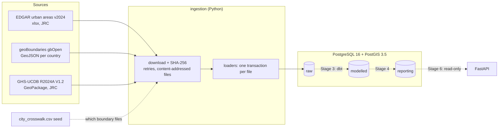

# city-emissions-platform

A small, production-shaped data platform for **city-level greenhouse-gas emissions**.
It ingests open emissions data and city boundaries, models them in layered
PostgreSQL/PostGIS storage with dbt, orchestrates with Dagster, and serves curated
data through a read-only FastAPI service.

> **Status: work in progress.** Stages 1–2 are built; Stage 3 (dbt) is next.
> See [Build status](#build-status). This README describes only what exists today and
> marks everything planned as such.

## Build status

| Stage | Scope | Status |
|---|---|---|
| 1 | Repo structure, Docker Compose, PostGIS, schemas and roles | ✅ Done |
| 2 | Source verification, Python ingestion into `raw`, dataset versioning, load checks | ✅ Done |
| 3 | dbt: modelled layer, seeds, tests | ⏳ Planned |
| 4 | Reporting layer and dbt snapshots | ⏳ Planned |
| 5 | Dagster orchestration | ⏳ Planned |
| 6 | FastAPI service and tests | ⏳ Planned |
| 7 | GitHub Actions CI | ⏳ Planned |
| 8 | Full docs, diagrams, ADRs | ⏳ Planned |

**Stage 2 items**

1. ✅ **Synthetic EDGAR fixture.** Real EDGAR rows are deliberately *not* committed (see
   [licences](#data-sources--licences)). The offline sample uses a synthetic file with
   EDGAR's exact structure and invented values. See [Synthetic EDGAR fixture](#synthetic-edgar-fixture).
2. ✅ **Separate `warehouse_test` database.** Tests run only against `warehouse_test`,
   whose roles cannot connect to `warehouse`. See [Testing](#testing).
3. ✅ **GHS-UCDB urban-centre polygons.** The polygons EDGAR's emissions are computed on
   are loaded into `raw` with load checks. See [GHS-UCDB urban centres](#ghs-ucdb-urban-centres).
   The overlap with administrative boundaries is *not* computed here: it belongs to dbt
   (Stage 3), as decided in [ADR 0001](docs/adr/0001-urban-centre-overlap.md).

## Architecture (current)



Dotted lines are planned.

### Layered schemas and access

| Schema | Contents | Written by | Read by |
|---|---|---|---|
| `raw` | Source data exactly as loaded, plus `dataset_versions`. Append-only. | `pipeline` role | `pipeline` |
| `modelled` | Cleaned, typed, conformed data (planned, dbt) | `pipeline` | `pipeline` |
| `reporting` | Aggregates the API serves (planned, dbt) | `pipeline` | `pipeline`, **`api_reader`** |

The database enforces "the API never reads raw": `api_reader` has `SELECT` on
`reporting` only, and gets `permission denied` on `raw`. `ALTER DEFAULT PRIVILEGES`
keeps that grant on tables that dbt drops and recreates. See `db/init/01-init.sh`.

### Raw tables


## Quick start

Requires Docker and [uv](https://docs.astral.sh/uv/) (uv installs Python 3.12 itself).

```bash
cp .env.example .env                 # then change the passwords
docker compose up -d --wait          # PostGIS on 127.0.0.1:5434 (warehouse + warehouse_test)
uv sync                              # Python 3.12 environment from uv.lock

uv run python -m ingestion load --mode sample     # offline: synthetic EDGAR + real boundary and urban-centre extracts
uv run python -m ingestion load --mode download   # real files (~25 MB EDGAR, ~70 MB boundaries, 277 MB GHS-UCDB)
uv run pytest -q                                  # runs against warehouse_test only
```

Re-running a load is safe: a file whose SHA-256 is already recorded is skipped.

> **Sample mode loads synthetic emissions.** Use it to try the pipeline offline. Any
> emissions number it produces is invented. Use `--mode download` for real data.

**Created your volume before `warehouse_test` existed?** The init scripts only run on an
empty volume. Add it without losing data:

```bash
docker compose up -d --wait   # recreate the container so it sees the TEST_* variables
docker compose exec db bash /docker-entrypoint-initdb.d/02-test-db.sh   # idempotent
```

Inspect what was loaded:

```bash
docker compose exec db psql -U climate -d warehouse -c \
  "SELECT dataset_version_id, source_name, source_key, origin, row_count, left(file_sha256,12), loaded_at
   FROM raw.dataset_versions ORDER BY 1"
```

`docker compose down -v` deletes the database volume. The init scripts in `db/init/`
only run against an empty volume.

## Project layout

```
db/init/
  01-init.sh                warehouse: roles pipeline + api_reader (runs once on an empty volume)
  02-test-db.sh             warehouse_test: roles test_pipeline + test_api_reader (idempotent)
  lib/layers.sql            shared: PostGIS, schemas, CONNECT/USAGE/SELECT grants
ingestion/
  __main__.py               CLI: load --mode sample|download, make-sample, make-synthetic
  config.py                 source URLs, paths, DB settings (.env)
  download.py               streaming download, SHA-256, retries with backoff
  versioning.py             raw.dataset_versions: idempotent registration
  edgar.py                  EDGAR workbook reader + loader (fails loudly on layout change)
  geoboundaries.py          geoBoundaries API resolution, GeoJSON reader + loader
  gpkg.py                   GeoPackage reader: stdlib sqlite3 + GPKG blob header, no GDAL
  ghs_ucdb.py               GHS-UCDB loader + load checks (raw.load_checks)
  crosswalk.py              reads the city crosswalk seed
  pipeline.py               download / sample runs, one transaction per file
  sample.py                 rebuilds the boundary and GHS-UCDB samples; writes manifest.json
  synthetic.py              generates the SYNTHETIC EDGAR-shaped fixture (seeded, reproducible)
  sql/raw_tables.sql        raw DDL (idempotent)
transform/seeds/city_crosswalk.csv   the 25 cities: EDGAR id <-> geoBoundaries shape
data/sample/                committed offline sample + manifest.json
  edgar/…_SYNTHETIC.xlsx    invented values, real structure
  geoboundaries/            real polygons for the 25 cities, unmodified
  ghs_ucdb/…_crosswalk_cities.gpkg   the 25 crosswalk urban centres, one layer (160 KB)
data/raw/                   full downloads (git-ignored), named <sha256-prefix>_<file>
tests/                      pytest against warehouse_test: unit + rolled-back integration tests
transform/, orchestration/  dbt (Stage 3) and Dagster (Stage 5)
docs/adr/                   architecture / methodology decision records
```

`transform/` and `orchestration/` are deliberately not called `dbt/` and `dagster/`.
`dbt` is a Python namespace package, so a `dbt/` folder at the repo root gets merged
into it (`dbt.__path__` showed the repo folder). That would cause confusing import
bugs later.

## How ingestion works

**Dataset versions.** Every loaded file gets a row in `raw.dataset_versions` with its
source URL, SHA-256, size, download time, load time and licence. Every raw row carries
`dataset_version_id`. The modelled and reporting layers will carry it forward, so any
number can be traced back to the exact bytes it came from.

**Idempotency.** `(source_name, source_key, file_sha256)` is unique, and registration
uses `INSERT ... ON CONFLICT DO NOTHING`. The same bytes give a no-op. Changed bytes
give a new version, and the old one stays (raw is append-only). This is also safe when
two loads race.

**Failure handling.**
- Each file loads in its own transaction, so a failure leaves nothing half-written and
  never undoes files that already loaded.
- Downloads retry timeouts, 429 and 5xx with exponential backoff (~3 min worst case).
  geoBoundaries is served via GitHub LFS, which returns intermittent 504s.
- 404 and other client errors fail immediately.
- A failing country is reported, the run continues, and the CLI exits non-zero.

**Raw is untouched.** EDGAR rows are stored as JSON exactly as read, plus the unit the
source declares (`ton/year`). Boundaries are stored as GeoJSON. Typing, unpivoting,
unit handling, name repair and conversion to PostGIS geometry belong to the modelled
layer (Stage 3).

**Samples.** `data/sample/manifest.json` lists every committed file and where it came
from. Each file is loaded with the same loader as the real data.

| Sample file | `origin` | Built by | Provenance recorded |
|---|---|---|---|
| geoBoundaries GeoJSON (24 files) | `sample` | `make-sample` cuts the crosswalk cities out of the latest downloads | upstream URL + `upstream_sha256` + download time |
| GHS-UCDB GeoPackage | `sample` | `make-sample` copies the 25 crosswalk urban centres of one layer out of the latest download | upstream URL + `upstream_sha256` (of the zip) + download time; licence text lists the changes |
| EDGAR workbook | `synthetic` | `make-synthetic` generates it, no download involved | `source_url = synthetic:ingestion/synthetic.py`, no upstream hash |

### Synthetic EDGAR fixture

`ingestion/synthetic.py` writes `EDGAR_emiss_on_UCDB_2024_SYNTHETIC.xlsx`:

- **Same structure as EDGAR v2024.** Same sheet names, the `Units` row, and the 195-column
  header (`ID_UC_G0`, `UC_name`, `UC_country`, then `EMI_<pollutant>_<sector>_<year>`).
  The generated header was checked against the real file and is identical.
- **Invented values.** Every number comes from a seeded random generator. Columns
  stay internally consistent: total GHG in CO2e is never below CO2, and nothing is
  negative.
- **Deliberate edge cases** for the modelled layer:
  - the mis-encoded names exactly as EDGAR has them (`São Paulo`, `México`);
  - a second `Lagos, Nigeria` with a fake ID (990001), so a join by name would
    double-count Lagos;
  - an urban centre outside the crosswalk (990002);
  - a sector that is zero in every year.
- **Clearly labelled.** The filename, the first sheet ("SYNTHETIC DATA - NOT EDGAR"),
  the manifest and `raw.dataset_versions.origin = 'synthetic'` all say so.
- **Byte-for-byte reproducible.** An `.xlsx` is a zip, and openpyxl stamps entries and
  the `modified` property with the current time. The generator pins both, so
  regenerating gives the same SHA-256 and therefore no new dataset version.

The urban-centre IDs and names in it are real. They come from the GHS Urban Centre
Database (CC BY 4.0) and are needed to match the crosswalk.

## GHS-UCDB urban centres

EDGAR computes emissions per GHS urban centre. To compare those territories with the
administrative boundaries, the urban-centre polygons are loaded from
[GHS-UCDB R2024A V1.2](https://human-settlement.emergency.copernicus.eu/ghs_ucdb_2024.php)
(a 277 MB zip holding one 285 MB GeoPackage with 16 layers).

- **One layer.** All 15 thematic layers repeat the same 11,422 polygons. Only
  `GHSL_UCDB_THEME_GENERAL_CHARACTERISTICS_GLOBE_R2024A` is loaded: ID, names, country,
  area, population, geometry.
- **No GDAL.** `ingestion/gpkg.py` reads the file with stdlib `sqlite3` and parses the
  GeoPackageBinary header (magic, flags, SRS id, envelope) itself. The WKB after the header
  goes to PostGIS untouched (`ST_GeomFromWKB`). Header parsing is tested on constructed
  blobs (both byte orders, every envelope size, malformed input) and on the 25 real
  polygons, against an independent pure-Python WKB reader.
- **Stored as published.** Native CRS (World Mollweide, ESRI:54009), no reprojection, no
  repair. The downloaded zip is the dataset version. The extracted `.gpkg` next to it is
  a cache named after the zip's hash.

### Load checks

Every GHS-UCDB load runs these checks in the same transaction as the rows. A failing
check raises and rolls the file back. Passes and warnings go to `raw.load_checks`.

| Check | Fails when | Result on the full file (11,422 polygons) |
|---|---|---|
| `row_count` | rows in raw ≠ features in the layer | pass: 11,422 = 11,422 |
| `gpkg_header` | a blob's SRS id ≠ the layer's, or its envelope ≠ the bounds PostGIS computes from the WKB | pass: 0 mismatches |
| `srid` | layer SRS is not ESRI:54009, it is missing from `spatial_ref_sys`, or a stored SRID differs | pass: all 54009 (`World_Mollweide`, present in the stock PostGIS image) |
| `geometry_type` | anything other than (MULTI)POLYGON | pass: 11,422 MULTIPOLYGON |
| `geometry_valid` | never fails; warns on invalid polygons | **warn: 22 invalid** (all ring self-intersections, none of our 25 cities); `ST_CollectionExtract(ST_MakeValid(geom), 3)` repairs all 22 |
| `area_vs_source` | warns if `ST_Area` differs from the source's `GC_UCA_KM2_2025` by > 5% | pass: identical for all 11,422 (the polygons are unions of 1 km² Mollweide cells) |
| `id_match_edgar` | null or duplicate IDs, or a crosswalk city missing from UCDB | **warn: 11,422 matched, 264 EDGAR-only, 0 UCDB-only**; all 25 crosswalk cities present in both |

Inspect them:

```bash
docker compose exec db psql -U climate -d warehouse -c \
  "SELECT check_name, status, detail->>'summary' FROM raw.load_checks ORDER BY dataset_version_id, check_name"
```

### Overlap with administrative boundaries (Stage 3, decided)

Computed in dbt, not ingestion. The full decision and its reasoning are in
[ADR 0001](docs/adr/0001-urban-centre-overlap.md).

- **Staging repairs geometry** with `ST_CollectionExtract(ST_MakeValid(geom), 3)`. Raw is
  never modified.
- **Areas are compared in Mollweide** (ESRI:54009), with boundaries transformed from 4326.
- **Flag** `low_urban_overlap` when *share of the urban centre inside the boundary* <
  `var('min_urban_overlap')`, **default 0.5**. IoU and *share of the boundary covered*
  are reported as information.
- **The 0.5 is a methodology decision for domain specialists** (city GHG inventory
  practitioners), not an engineering one. It is a dbt var so it can be changed without
  touching code.

**Is Mollweide safe for this?** For ratios, yes. For absolute km², not quite. PROJ's
Mollweide is a spherical projection applied with the WGS84 semi-major axis, so absolute
areas of our 25 boundaries are off by **up to 0.67%** (latitude-dependent) against
ellipsoidal `geography` areas. The error is nearly the same for both polygons of a city,
so it cancels in the overlap share. The share computed in Mollweide differs from the
geodesic one by at most **1.9 × 10⁻⁵** across all 25 cities (asserted in
`tests/ingestion/test_ghs_ucdb_db.py`). Absolute boundary areas, where reported, should use
`geography`.

## Testing

```bash
uv run pytest -q                    # DB tests skip if Postgres is down
REQUIRE_TEST_DB=1 uv run pytest -q  # CI: an unreachable test DB is a failure
```

Tests can never touch the real warehouse. There are three independent layers:

1. **Credentials.** Tests connect as `test_pipeline`. `db/init/lib/layers.sql` revokes
   `CONNECT` from `PUBLIC` on each database and grants it only to that database's own
   roles, so `test_pipeline` → `warehouse` fails with *permission denied for database*.
   `tests/test_db_isolation.py` asserts exactly that.
2. **Name guard.** The session refuses to start unless `TEST_POSTGRES_DB` ends in `_test`,
   and the fixture re-checks the connected database name.
3. **Settings override.** For the whole session, `PIPELINE_*` and `POSTGRES_DB` point at
   the test values, so code under test that builds its own connection also lands on
   `warehouse_test`.

Each DB test also runs inside `conn.transaction(force_rollback=True)`. The pipeline's own
per-file transactions nest inside it as savepoints, so every test starts from an empty
database. (An earlier version of the fixture lacked this and committed for real. On an
idle connection, psycopg's `conn.transaction()` *is* the outermost transaction.)

## City matching (crosswalk)

The platform covers **25 cities in 24 countries, 11 of them in Africa**:
Kigali, Nairobi, Lagos, Bujumbura, Kampala, Addis Ababa, Dar es Salaam, Accra,
Johannesburg, Cape Town, Dakar, Kinshasa, Cairo, Buenos Aires, Mexico City, Bogotá,
Lima, Delhi, Jakarta, Bangkok, Seoul, Tokyo, Berlin, Paris, São Paulo.

`transform/seeds/city_crosswalk.csv` maps each city to an EDGAR urban-centre ID
(`edgar_uc_id`) and a geoBoundaries shape (`gb_shape_id`). Every row also has:

- `match_note`: why this unit was chosen and anything known to be wrong with it.
- `review_status`: `accepted` (unit choice documented, no known problem) or
  `needs_review` (a known problem that a person has to resolve). `accepted` is an
  engineering judgement. No city GHG inventory specialist has reviewed the list yet.

Two cities are `needs_review`: **Accra** and **Buenos Aires**. In both the unit is right
but geoBoundaries' polygon for it is not (see [data quality](#data-quality-findings-so-far)).

The join is by ID and never by name, because names in these sources are unreliable:

- EDGAR has **192 duplicate (name, country) pairs**.
- Spellings differ: `Dar es-Salaam`, and Delhi's urban centre is `Ghaziabad [New Delhi]`.
- The obvious admin match can be wrong. geoBoundaries' UK ADM2 has *City of London*,
  the 2.9 km² financial district, not Greater London (33 boroughs). London is therefore
  **excluded** rather than silently mismatched.
- The right admin level varies by country. Uganda's ADM1 is only 4 regions, so Kampala
  is ADM2. Lima uses the metropolitan municipality, not the Lima region.

`make-sample` fails if any crosswalk `gb_shape_id` is missing upstream, which would mean
geoBoundaries re-issued its IDs.

## Data quality findings so far

| Finding | Where | Handling |
|---|---|---|
| 775 names mis-encoded (UTF-8 read as Latin-1), e.g. `São Paulo`, `México` | EDGAR source file | Kept as-is in raw; repair planned in the modelled layer |
| 192 duplicate (name, country) pairs | EDGAR | Join on IDs via the crosswalk |
| No negative or blank values across 11,686 rows | EDGAR | Will become a dbt test |
| Licence text truncated inside the file ("Unl…", "compli…") | EDGAR citations sheet | Licence recorded only as far as verified |
| Intermittent HTTP 504 | geoBoundaries (GitHub LFS) | Retries with backoff; per-file isolation |
| Urban centre ≠ administrative area | EDGAR vs geoBoundaries | Overlap share + flag in dbt (Stage 3, [ADR 0001](docs/adr/0001-urban-centre-overlap.md)) |
| 264 EDGAR urban-centre IDs are not in GHS-UCDB V1.2 (mostly small centres in Yemen, Ethiopia, Iran, Sudan). EDGAR's IDs run 1–11,686 without gaps; V1.2 has 11,422 of them | EDGAR v2024 vs GHS-UCDB V1.2 | Reported by `id_match_edgar`. None are crosswalk cities. EDGAR was evidently built on an earlier UCDB release with 11,686 centres, so a matched ID's V1.2 polygon *may* differ from the one EDGAR used (see limitations) |
| 379 matched IDs have a different name in EDGAR and UCDB after repairing mojibake, e.g. `San Jose` / `San Francisco` (same Bay Area centre), `New York` / `New York City`; one country differs (`Caspian Sea` / `Russia`, ID 143) | EDGAR vs GHS-UCDB | Naming conventions, not different places, in the cases checked. Another reason to join on ID. All 25 crosswalk cities agree (Delhi: `Ghaziabad [New Delhi]` / `New Delhi`) |
| 22 invalid polygons (ring self-intersection) | GHS-UCDB | Kept in raw; `ST_MakeValid` in dbt staging; none are crosswalk cities |
| geoBoundaries' *Accra Metropolis* is 5.7 km² (5.6 km² in the full-resolution file, so not a simplification artefact). The official area of today's Accra Metropolitan District is **20.4 km²** (Ghana Statistical Service, 2021 PHC General Report Vol. 3A, p. 80). Only 0.5% of the 1,121 km² urban centre lies inside the polygon | geoBoundaries GHA ADM2 (2019 districts, source "USAID Ghana HPNO, Ghana Statistical Service") | Checked 2026-11-07. The **unit is right**: Accra Metropolis *is* the Accra Metropolitan Assembly, which Ghana cut down to a small core when it created 9 new districts in 2018–19. The **polygon is not**: it is ~28% of the official area. Crosswalk unchanged; `review_status = needs_review`. Stage 3's 0.01 overlap test warns on it |
| geoBoundaries' *Ciudad Autónoma de Buenos Aires* is 948 km² and extends into the surrounding partidos. The official area is ~203 km² (Buenos Aires city government) | geoBoundaries ARG ADM1 (source "geoBoundaries, Wikimedia", year 2006) | Found while checking Accra. Same situation: right unit, wrong polygon. Crosswalk unchanged; `needs_review`. Its overlap share (0.40) looks plausible, so only an area check catches this. Stage 3 plan adds one |

## Data sources & licences

| Source | Used for | Licence | Committed to this repo? |
|---|---|---|---|
| **EDGAR – Global emissions in urban areas, v2024** (European Commission, JRC) [dataset page](https://edgar.jrc.ec.europa.eu/dataset_ucdb) | GHG per urban centre and sector, 1975–2022, t CO2e (GWP100, AR5) | © European Union 2024, JRC. The IEA-EDGAR CO2 component (fossil fuel combustion) is **CC BY-NC-ND 4.0**. The general licence text is truncated in the file and not stated on the [terms page](https://edgar.jrc.ec.europa.eu/terms). | **No real rows.** Downloaded at run time. The repo holds only a [synthetic fixture](#synthetic-edgar-fixture) with EDGAR's structure and invented values. |
| **geoBoundaries gbOpen** (William & Mary geoLab) [geoboundaries.org](https://www.geoboundaries.org) | Administrative boundaries, ADM1/ADM2 | Per country, see below | Yes: one polygon per city, unmodified, in `data/sample/geoboundaries/` |
| **GHS Urban Centre Database R2024A, V1-2** (European Commission, JRC, GHSL) [product page](https://human-settlement.emergency.copernicus.eu/ghs_ucdb_2024.php) | Urban-centre polygons; urban-centre IDs and names in the synthetic fixture | **CC BY 4.0**, per the V1-2 [`copyright.txt`](https://jeodpp.jrc.ec.europa.eu/ftp/jrc-opendata/GHSL/GHS_UCDB_GLOBE_R2024A/GHS_UCDB_GLOBE_R2024A/V1-2/copyright.txt) (re-checked 2026-11-06): reuse allowed with credit and with changes indicated | Yes: the 25 crosswalk urban centres, one layer, attributes and geometry unchanged (160 KB). The changes are listed in `manifest.json` |

EDGAR citation (from the dataset page): Crippa, M. et al., *EDGAR_emissions_urban_areas*,
European Commission, Joint Research Centre (JRC), http://data.europa.eu/89h/c0c49cd7-4a80-4a94-8c34-375289c12b2d.
See also Crippa et al. (2021), *Environmental Research Letters* 16, 074033,
doi:10.1088/1748-9326/ac00e2.

GHS-UCDB citation (from the dataset readme): Mari Rivero, I.; Melchiorri, M.; Florio, P.;
Schiavina, M. et al. (2024): *GHS-UCDB R2024A - GHS Urban Centre Database 2025*. European
Commission, Joint Research Centre (JRC). doi:10.2905/1a338be6-7eaf-480c-9664-3a8ade88cbcd

geoBoundaries citation: Runfola, D. et al. (2020), *geoBoundaries: A global database of
political administrative boundaries*, PLoS ONE 15(4): e0231866.

**geoBoundaries licences per file** (as reported by the geoBoundaries API; each file is
fetched from a commit-pinned GitHub URL, recorded in `raw.dataset_versions.source_url`):

| Licence | Countries |
|---|---|
| CC BY 4.0 | ETH, GHA, NGA, RWA |
| CC BY 3.0 IGO | BRA, MEX, SEN, ZAF |
| CC BY 2.5 (Generic / India) | ARG, IND |
| ODbL 1.0 (share-alike for databases) | COD, COL, EGY, IDN, JPN, THA, TZA |
| Data licence Germany – Attribution 2.0 | DEU |
| Etalab Open Licence 2.0 | FRA |
| Public domain / CC0 | BDI, KEN, KOR, PER, UGA |

**Sources evaluated and not used**

- **CDP open data** (data.cdp.net) returns HTTP 403 to automated clients. A scheduled
  pipeline cannot depend on it, and its bot protection was not circumvented.
- **Climate TRACE**: the API is officially beta, and a city search for "Kigali" returned
  no results. Its city data is offered via manual downloads on the Explore page.

## Design decisions (so far)

- **Schemas, not separate databases, for layers.** dbt has to join across layers, and
  Postgres cannot join across databases without extensions.
- **Least-privilege roles enforced in the database**, not by convention.
- **Raw rows as JSONB.** A new year column upstream does not break the load, and raw
  stays exactly as published.
- **Content-hash dataset versions.** The SHA-256 *is* the version, which gives
  idempotency and lineage from one mechanism.
- **Admin boundaries plus a reviewed crosswalk, joined by ID.** Cities report emissions
  for their administrative territory, and names are too unreliable to join on.
- **Synthetic, not real, EDGAR rows in the repo.** It respects the ND licence term while
  still testing the real loader, file format and known data-quality problems offline.
- **A separate test database with its own roles**, so isolation is enforced by
  Postgres permissions rather than by careful configuration.
- **GeoPackage read without GDAL.** The format is SQLite plus a small documented header.
  Parsing it in ~100 lines avoids a heavy native dependency in the pipeline image, and every
  load cross-checks the parsed header against PostGIS.
- **Load checks stored next to the data** (`raw.load_checks`), so a warning such as
  "22 invalid polygons" is queryable lineage, not a log line that scrolls away.
- **Python 3.12 only.** dagster-dbt 0.29.28 declares `requires_python <3.14`. uv
  ignores that cap and would install on 3.14, but pip correctly refuses, so 3.14 is
  unsupported here. 3.11–3.13 all install and import cleanly.

## Known limitations

- **Urban centre ≠ city boundary.** EDGAR measures a satellite-derived urban centre,
  while boundaries are administrative. Extents can differ greatly; Jakarta's urban
  centre (123 Mt CO2e) extends well beyond DKI Jakarta. The overlap share and flag arrive
  with Stage 3. Until then, do not read an emissions figure as "emissions inside this
  boundary".
- **EDGAR v2024 was built on an earlier GHS-UCDB release than the polygons loaded.**
  EDGAR uses 11,686 urban-centre IDs; GHS-UCDB V1.2 (loaded here) has 11,422. For the 25
  crosswalk cities the IDs, names and countries match, but **the shapes are not verified
  identical** to those EDGAR computed emissions on. Checking would need the older
  release (another 277 MB). Overlap figures therefore describe the V1.2 polygon, which
  may differ from EDGAR's territory.
- **geoBoundaries polygons are not checked against official areas** except for Accra
  and Buenos Aires, both found wrong. Stage 3 adds an area check.
- **Downloads are not cached.** `load --mode download` re-fetches every file, including
  the 277 MB GHS-UCDB zip (25 min on the JRC server on 2026-11-06, 90 s on 2026-11-07);
  identical bytes are then skipped at load (`skipped (already loaded)`, with the
  matching version id).
- **London is excluded:** no single geoBoundaries unit for Greater London at ADM2.
- **No migrations tool yet.** The raw DDL is `CREATE TABLE IF NOT EXISTS`, so changing an
  existing table needs a manual `ALTER` (or recreating the volume). Example: widening the
  `origin` check to include `synthetic` on an existing database:
  ```sql
  ALTER TABLE raw.dataset_versions DROP CONSTRAINT dataset_versions_origin_check;
  ALTER TABLE raw.dataset_versions ADD CONSTRAINT dataset_versions_origin_check
    CHECK (origin IN ('download', 'sample', 'synthetic'));
  ```
- **Offline runs show invented emissions.** The synthetic fixture is for testing only.

## Next steps

Stage 3 (dbt): staging models with geometry repair, the overlap model and
`min_urban_overlap` flag from [ADR 0001](docs/adr/0001-urban-centre-overlap.md), and tests.
