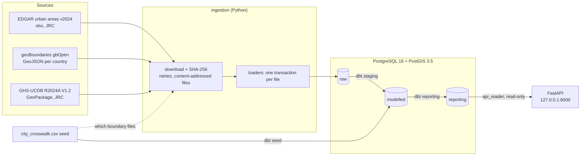
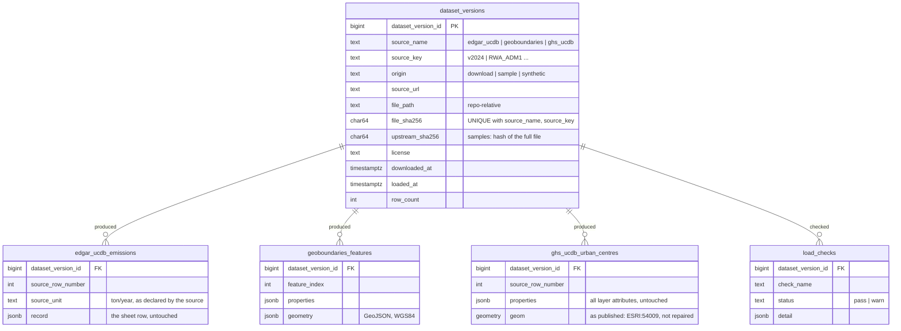

# Architecture

Layers, raw tables and repository layout. Back to the [README](../README.md).

## Architecture (current)



Dotted lines are a lookup rather than data flow (which boundary files to fetch).

### Layered schemas and access

| Schema | Contents | Written by | Read by |
|---|---|---|---|
| `raw` | Source data exactly as loaded, plus `dataset_versions`. Append-only. | `pipeline` role | `pipeline` |
| `modelled` | dbt seeds, `stg_*` staging models, and the modelled layer (dims, facts, overlap) | `pipeline` | `pipeline` |
| `reporting` | The tables the API serves (dbt, contract-enforced) | `pipeline` | `pipeline`, **`api_reader`** |

The database enforces "the API never reads raw": `api_reader` has `SELECT` on
`reporting` only, and gets `permission denied` on `raw`. `ALTER DEFAULT PRIVILEGES`
keeps that grant on tables that dbt drops and recreates. See `db/init/lib/layers.sql`.
That only works while dbt connects as `pipeline` (the role named in the default
privileges), so every build checks it: `tests/assert_api_reader_can_read_reporting.sql`.

### Raw tables



## Project layout

```
db/init/
  01-init.sh                warehouse: roles pipeline + api_reader (runs once on an empty volume)
  02-test-db.sh             warehouse_test: roles test_pipeline + test_api_reader (idempotent)
  lib/layers.sql            shared: PostGIS, schemas, CONNECT/USAGE/SELECT grants
db/corrections/             one-off, documented data corrections (each says what, why, how to run)
ingestion/
  __main__.py               CLI: load --mode download|sample [--target warehouse|test], make-sample, make-synthetic
  config.py                 source URLs, paths, DB settings (.env)
  download.py               streaming download, SHA-256, retries with backoff
  versioning.py             raw.dataset_versions: idempotent registration
  edgar.py                  EDGAR workbook reader + loader (fails loudly on layout change)
  geoboundaries.py          geoBoundaries API resolution, GeoJSON reader + loader
  gpkg.py                   GeoPackage reader: stdlib sqlite3 + GPKG blob header, no GDAL
  ghs_ucdb.py               GHS-UCDB loader + load checks (raw.load_checks)
  crosswalk.py              reads the city crosswalk seed
  pipeline.py               download / sample runs, one transaction per file
  sample.py                 rebuilds the boundary and GHS-UCDB samples; writes manifest.json
  synthetic.py              generates the SYNTHETIC EDGAR-shaped fixture (seeded, reproducible)
  sql/raw_tables.sql        raw DDL (idempotent)
transform/                  dbt project (Stage 3)
  dbt_project.yml, profiles.yml   targets: warehouse, test (warehouse_test)
  seeds/                    city_crosswalk.csv (25 cities), edgar_sector_map.csv, edgar_pollutants.csv
  models/staging/           stg_* : one version per source, names repaired, geometry repaired
  models/modelled/          dim_city, fct_urban_centre_emissions, fct_city_emissions, city_territory_overlap
  models/reporting/         what the API serves: cities, city_emissions, city_emissions_trend,
                            city_boundaries, city_overlap, dataset_versions, city_emission_revisions
                            (contracts enforced)
  snapshots/                snap_city_crosswalk, snap_edgar_sector_map (history of seeds edited in place)
  macros/                   raw_origins (guard), unpivot_edgar_emissions, repair_mojibake, overlap_metrics,
                            change_pct, schema naming
  tests/                    generic tests (no packages) + singular tests
data/sample/                committed offline sample + manifest.json
  edgar/…_SYNTHETIC.xlsx    invented values, real structure
  edgar/…_SYNTHETIC_REVISED.xlsx     2nd version: known corrections, Dakar's row missing
  edgar/…_SYNTHETIC_REVISED_2.xlsx   3rd version (current): Dakar back
  geoboundaries/            real polygons for the 25 cities, unmodified
  ghs_ucdb/…_crosswalk_cities.gpkg   the 25 crosswalk urban centres, one layer (160 KB)
data/raw/                   full downloads (git-ignored), named <sha256-prefix>_<file>
backups/                    snapshot backups from pg_dump (git-ignored)
scripts/dbt-build.sh        the one dbt build command (sets GIT_COMMIT); used locally and in CI
scripts/git-commit.sh       the GIT_COMMIT rule, shared by dbt-build.sh and Dagster
scripts/dagster-dev.sh      Dagster locally (UI on 127.0.0.1:3030)
scripts/ci_failure_summary.py   CI: failed pytest tests and dbt nodes -> the run's summary page
.github/                    workflows/ci.yml (CI), dependabot.yml (weekly action updates)
tests/                      pytest against warehouse_test: unit + rolled-back integration tests
  transform/                rules on the parsed dbt project; api reader access after dbt build
api/                        FastAPI over reporting (Stage 6); Dockerfile builds the `api` service
  main.py                   app factory, /health, /ready      settings.py   reader-role settings only
  db.py                     read-only engine, privilege check  queries.py    every SQL statement
  models.py                 response models + enums            docs.py       OpenAPI text (urban-centre caveat)
  routers/                  cities.py, datasets.py             params.py     pagination, year range, city id
orchestration/              Dagster (Stage 5); Dockerfile builds the dagster-webserver/-daemon image
  definitions.py            the code location: assets, checks, job, schedule, resources
  ingestion.py              the 3 sources as assets (wrap ingestion.pipeline)
  dbt.py                    dbt nodes as assets, dbt tests as checks, reporting freshness
  checks.py                 load_check_warnings      resources.py   PIPELINE_TARGET, GIT_COMMIT
  dagster.yaml              instance config: storage in the `dagster` database
docs/adr/                   architecture / methodology decision records
docs/openapi.json           the API contract (snapshot, checked by tests/api/test_openapi.py)
```

`transform/` and `orchestration/` are deliberately not called `dbt/` and `dagster/`.
`dbt` is a Python namespace package, so a `dbt/` folder at the repo root gets merged
into it (`dbt.__path__` showed the repo folder). That would cause confusing import
bugs later.
